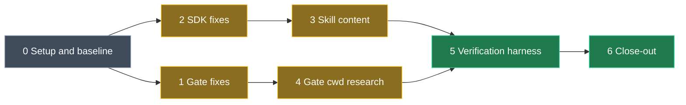

# AI skills and agent gate hardening

## What this is

The skills, rules and agent-gate hooks generated by the `Intent.ModuleBuilder.AI.*` modules must give a
module-building agent **guidance that produces working code** and a **gate that helps rather than
obstructs**. A real module-building session (the `Intent.Application.Mediator` family, built in
Intent.Modules.NET on branch `agent/mediator`) and five source audits found that today they do not:
code samples that don't compile, invented APIs, retired tool names, rules that contradict the SDK, a
gate that locks the agent out after a `cd`, and a Linux path bug that lets `guard-version` fail open.

This plan is the single source of truth for fixing all of it. It is written to be executed
unattended by one goal run.

<Callout id="how-to-use" tone="info" title="For the agent executing this plan">

1. Read the whole plan before starting. Work the phases **in order**.
2. Tick an item (`- [ ]` to `- [x]`) **only when its check has passed**, never on intent.
3. Precedence: **User decisions** (below) beat **Review defaults**, which beat any audit wording quoted in an item. Skills beat your own inference on *how* to implement (`.claude/rules/guidance-precedence.md`).
4. Every deviation from this plan, and the reason, goes in the **Progress log** at the bottom, in the same turn you deviate.
5. After **three failed attempts** at one item, mark it `BLOCKED` in the log with what you tried, and move on. Do not stall the run.
6. Follow `.claude/rules/module-building-workflow.instructions.md` for every module you touch. Load its four skills (`module-context-capture`, `module-version-increment`, `module-docs-chore`, `module-dependency-audit`) at the phases it names.
7. Skill and rule content lives in C# templates (`*TemplatePartial.cs`), never in the generated `.agents/` or `.claude/` copies. Load `local-add-module-skill-template` before editing any of them. AI.Modelers' `CONTEXT.md` requires whole-file `write_file`, not `patch_file`, for its templates.

</Callout>

## Scope

| Module | Package id | Version now | Why it is in scope |
| --- | --- | --- | --- |
| `Modules/Intent.Modules.ModuleBuilder.AI.Workflow` | `Intent.ModuleBuilder.AI.Workflow` | `1.0.0-pre.10` | Gate hooks, workflow rule, four process skills |
| `Modules/Intent.Modules.ModuleBuilder.AI.Skills` | `Intent.ModuleBuilder.AI.Skills` | `1.0.3` | Reference skills, `known-build-gotchas`, `exception-guidelines` |
| `Modules/Intent.Modules.ModuleBuilder.AI.Modelers` | `Intent.ModuleBuilder.AI.Modelers` | `1.0.0-pre.2` | `intent-modelers-integration` |
| `Modules/Intent.Modules.Common` | `Intent.Common` | `3.11.8-pre.0` | `MarkdownFileParser` splits wrapped bullets |
| `Modules/Intent.Modules.Common.CSharp` | `Intent.Common.CSharp` | `3.10.12-pre.0` | `Parent` not set on some builder statements |

**Out of scope:** Intent Architect's built-in skills (`scripting-the-model`, `generating-and-applying-code`,
`working-with-modules` and the rest marked `intent-updates: automatic`) and platform defects (the
original feedback's C1, C2, D5 and F). Intent.Modules.NET is out of scope too; see
**Hand-off: Intent.Modules.NET** at the end.

<Callout id="clients" tone="warning" title="These skills ship to client machines">

Third-party module developers install these modules. Every sample must compile for them: no
`Intent.Modules.Constants` / `TemplateRoles.*` (not published on nuget.org), no Intent.Modules.NET
internals presented as SDK, no Intent-repo paths. Check samples against Module Builder's default
dependency floors, `Intent.Common` 3.7.2 and `Intent.Common.CSharp` 3.8.0
(`Modules/Intent.Modules.ModuleBuilder/IntentModule.cs`, `Modules/Intent.Modules.ModuleBuilder.CSharp/IntentModule.cs`).
Where a skill teaches an API above a floor, it must also say to raise that floor.

</Callout>

## Decisions

### User decisions (final)

<Callout id="user-decisions" tone="decision" title="Decided by the user (Dandré), 2026-10-14">

1. **Scope** is everything below: the original feedback (A to E), the five source audits, and the adversarial review, including the two SDK fixes.
2. **`TemplateRoles.*`** in skills is replaced by literal role strings, plus one table of common role values. The table must call out the trap: the constant `TemplateRoles.Domain.Entity.Primary` has the value `"Domain.Entity"`, while the string `"Domain.Entity.Primary"` is a different role.
3. **`module-svg-icon`** keeps its current method (shell-editing `.application.config`), worded as a deliberate, approved exception to the off-limits rule.
4. **Tags are hyphenated** (`entity-framework`). Align `module-docs` to `module-docs-chore`.
5. **The gate's working-directory problem is a research and experiment item** (Phase 4): research online, try each candidate here, implement the best one that holds up, record why in `CONTEXT.md`, mark what can't be verified here as unverified.
6. **`guard-write` extends to Intent's MCP file tools** (`write_file`, `patch_file`, `delete_code_file`). Shell writes stay a documented gap.
7. **AI task providers are deprecated.** New modules carry AI guidance through designer `AI Settings` → `Rules` plus generated `SKILL.md` files, and must not register task providers. The loss of proactive "this handler still needs writing" flagging is an **accepted trade-off**; no proactive replacement exists or is planned.
8. **The `.csproj` gotcha (D4)** recommends modelling `Nullable` on the module's `C# Project (.NET)` element (`C# Project Options` → `Nullable`).
9. **`known-build-gotchas`:** NuGet registration stays in the template constructor; `GetTypeName` and other template lookups go in `OnBuild` / `AfterBuild`. The `Intent.Modules.Constants` gotcha leaves the shipped file.
10. **Verification:** samples must compile against the dependency floors, a module built by following the skills must generate compiling output, and guidance is tested in a fresh Intent Architect 5.4 nightly under Xvfb (no sign-in needed) plus `Tests/AgentEvals` with Claude Code.
11. **Leave everything uncommitted.** No commits, push, PR or publishing.
13. **Added mid-run (2026-10-14), asked because 5.5 and 6.2 could not otherwise test the new content:** `Tests/ModuleBuilderSkills` and the dogfood app `ModuleBuilderAiSkills` may be updated to the new versions of the four changed modules (version updates only, one module at a time). This supersedes "never in `Tests/ModuleBuilderSkills`" in 5.3 and "regeneration only, no installs" in 5.5. For the virtual instance stuck at sign-in, the user said: "kill it and restart".
12. **Added mid-run (2026-10-14):** the doc skills must not announce that something is beta or pre-release - no "(beta)", "preview" or "pre-release" labels in release notes, READMEs, summaries or descriptions. Applies to `module-docs` and `module-docs-chore` (item 3.9.3).
14. **Added mid-run (2026-10-15), refining decision 9:** don't tell the reader never to add a NuGet dependency in a callback. A callback works as long as it runs early enough: the constructor and `OnBuild` both run before packages are collected at `BeforeTemplateExecution` (Order 1000); only `AfterBuild` is too late.

</Callout>

### Review defaults (change one only with a logged reason)

These came out of the adversarial review of the first plan. Each one corrects a fix that would have regressed something.

| Topic | Default | Why |
| --- | --- | --- |
| Gate cwd | **Not** `$CLAUDE_PROJECT_DIR` in hook commands | Copilot runs `.claude/settings.json` under PowerShell on Windows, where `$CLAUDE_PROJECT_DIR` is an empty PowerShell variable: every write would be denied |
| `Parent` fix | Fix `CSharpCollectionExpression.AddItem` and `CSharpSwitchCodeBlock.AddStatement` only | A parent on a lambda's expression body renders a stray `;` (`CSharpLambdaBlock.cs:49`, `CSharpCollectionExpression.cs:55`) |
| Assignment search | Special-case `Rhs` in the `FindStatements` traversal; do **not** add `Rhs` to `Statements` | `GetText` renders the `Rhs` field, so list edits would silently not render; ~205 `FindStatement` callers in Intent.Modules.NET would change results |
| D1 (template presence) | Teach `ExecutionContext.TemplateExists(idOrRole, t => t.CanRunTemplate())` as **opt-in**, inside a build callback | Stub templates set `CanRun = false` in `AfterBuild(…, 100)` deliberately so types still resolve (SharedKernel.Consumer, AspNetCore.Identity in Intent.Modules.NET) |
| `SingleFileListModel` | One type per template needs no name. Several types: use `.WithFileName(...)` | Model order is designer order; the name changes when the model *set* changes, which sorting doesn't prevent |
| `FriendlyException` | Renders Markdown, but must read cleanly as plain text; throw it only outside builder callbacks | `FileBuilderHelper.cs:47-66` wraps every non-`ElementException` thrown in `OnBuild`/`AfterBuild`; the CLI prints raw text |
| Dependency audit | Offer both: metadata-only install, or a hand-added `<dependency>`, with trade-offs | Metadata-only pins to the installed version and keeps raising it (`IModSpecTemplate.cs:284-292`) |
| Catch-block matching (D7) | Tag the catch block with metadata and match on the tag | `ExceptionType` holds whatever the producer passed (gRPC passes `"Exception e"`) |
| Obsolete legacy role (D6) | Probe the raw role string `"Application.Eventing.EventBusInterface"`; no `#pragma` | Avoids the obsolete constant entirely |
| Markdown bullets | Fix the parser in `Intent.Common`; raise the `Intent.Common` dependency in every module relying on it | Root cause is `MarkdownFileParser.cs:100-125`; template-side indentation doesn't help |

<Callout id="accepted-shell" tone="warning" title="Accepted: shell writes bypass the gate">

Hooks see file-edit tools and MCP calls, not what a shell command writes. A `sed -i` on an `.imodspec`
goes around the gate. Accepted (recorded in AI.Workflow `CONTEXT.md`): parsing arbitrary shell for
writes is unreliable and produces false positives. Document it; don't block it.

</Callout>

<Callout id="accepted-windows" tone="warning" title="Accepted: Windows and PowerShell can't be verified here">

This machine is Linux. Every gate decision so far was measured on Windows. Anything this run changes
that behaves differently under PowerShell, cmd or Git Bash on Windows is marked **unverified on
Windows** in `CONTEXT.md`, the release notes and the final report, rather than assumed.

</Callout>

## Phases

*Grey: setup. Amber: changes. Green: verification and close-out.*

### Phase 0: Setup and baseline

- [x] **0.1 Version gate.** For each of the five modules, load `module-version-increment` and run its "Is this version already in flight?" gate. Increment only where a published version exists at or beyond the current one. Log each result. (The last commit "released" AI.Workflow `1.0.0-pre.10`, so expect it to need a bump.)
- [x] **0.2 Toolchain for Software Factory runs.** Decide and log how module and consumer applications get regenerated: the Intent MCP connection this run was launched with, for this repository's solution; the virtual instance (Phase 5) for sandbox applications. Never let two Intent instances write the same solution at once.
- [x] **0.3 Baseline.** Record before changing anything: `dotnet test Tests/AgentGate` result; `dotnet test` for `Modules/Intent.Modules.Common.Tests` and `Modules/Intent.Modules.Common.CSharp.Tests`; a build of each module in scope; and a copy (outside the repo) of the generated `.agents/` tree, so later diffs are provable.

### Phase 1: Gate fixes (AI.Workflow)

The gate's source is embedded as string constants in
`Modules/Intent.Modules.ModuleBuilder.AI.Workflow/Templates/Hooks/GateScripts/GateScriptsTemplateRegistration.cs`.
**Every item needs a `Tests/AgentGate` test that fails without the change.**

- [x] **1.1 Backslash `location` on Linux.** `ModuleDiscovery.FindAll` (~line 569-571) combines `location="..\X"` without converting `\`, so on Linux the output root doesn't exist. Effects: close-out names the wrong modules ("Modules", observed in the Mediator session), and `ModuleResolver.FindModuleFolderByApplicationId` returns a missing folder, so **`guard-version` allows the call (fails open)**. Fix: convert `\` to `/` before combining. Tests: close-out and guard-version with a backslash `location`.
- [x] **1.2 `FindImodspecUnder` false attribution.** For an application whose output root is a parent folder (e.g. `Modules/` via `location=".."`), it takes the first immediate subfolder's `.imodspec`, skipping only folders that contain an `.application.config`. Folders whose config sits elsewhere (Intent.Modules.NET's AzureFunctions modules) are still attributed. Fix: skip any subfolder that is another discovered application's output root.
- [x] **1.3 `.imodspec` snippet guard false denials.** `ImodspecFieldGuard.IsHandEditAllowed` (~line 1488) denies any partial edit whose text merely *contains* `
` or `<description>`. A version edit carrying `
` as unchanged context is denied with a misleading message. Fix: compare the field between old and new snippets (Edit's `old_string`/`new_string`; `patch_file`'s `searchBlock`/`replaceBlock`).
- [x] **1.4 Guard Intent's MCP file tools** (user decision 6). Matchers must not depend on the server name: `.*(write_file|patch_file|delete_code_file).*`, as `guard-version` already does with `.*run_designer_script.*`. Keep Copilot's matcher narrow (`IsReadOnlyTool` compares exact names). Path keys `filePath` / `file_path` / `path` are already read (~line 748); add `content`, `searchBlock`/`replaceBlock`. Relative paths from these tools resolve against Intent's workspace, not the git root: handle that. Extend `Tests/AgentEvals/McpStub.cs` to expose the file tools.
- [x] **1.5 Cursor MCP payloads.** If Cursor sends `tool_input` as a JSON string, `HookPayload.Normalize` decodes only Copilot's `toolArgs`, so the path is null and the call is allowed. Decode a string `tool_input` generically. Add a Cursor MCP payload test.
- [x] **1.6 Failure table** in `Templates/RootPrinciples/ModuleBuildingWorkflowMd/ModuleBuildingWorkflowMdTemplatePartial.cs` (~lines 42-53): delete the "`gate.cs` itself cannot be found" row (no `dotnet` error reads like that); add the working directory as a cause of `Couldn't find a project to run`; add a row for "Unable to proceed with project … OutputType 'Library'" (same cause). The working-directory case is one the agent fixes itself, not reports to the user: carve it out of the "tell the user" instruction. Final wording depends on Phase 4.
- [x] **1.7 "Installs fail" branch** in the workflow rule's "If A Phase Cannot Be Completed": stop verification and report it; list what can still be done (build, docs, `CONTEXT.md`, dependency audit by reading code); mark generated output as unverified in every document; never edit `modules.config` or `.intent` to force an install.

### Phase 2: SDK fixes

- [x] **2.1 Markdown bullet continuation** in `Modules/Intent.Modules.Common/FileBuilders/MarkdownFileBuilder/MarkdownFileParser.cs` (~lines 100-125). A list item takes one line; following lines become a separate text block rendered after a blank line, splitting the bullet mid-sentence. Fix: append continuation lines to the current list item, stopping at a blank line, `|`, `>`, `===`, a fence or a heading. Tests in `Modules/Intent.Modules.Common.Tests`. Then raise the `Intent.Common` dependency (`.imodspec` and `.csproj`) in AI.Workflow, AI.Skills and AI.Modelers. Regenerate and confirm the split bullets are gone (examples: `module-dependency-audit`, the workflow rule, `add-module-migration`, `services.md` / `eventing.md` in `intent-modelers-integration`, and `module-building-strategies`, whose indented lists render as code blocks).
- [x] **2.2 `Parent` on collection items and switch statements** in `Modules/Intent.Modules.Common.CSharp/Builder/`: set `statement.Parent = this` in `CSharpCollectionExpression.AddItem` (both overloads, ~lines 26-39) and `CSharpSwitchCodeBlock.AddStatement`, mirroring `CSharpInvocationStatement.AddArgument`. **Not** on expression bodies (review default). Check the `AddInvocation`-replaces-when-parented path (`IHasCSharpStatements.cs:400`) doesn't produce `[a.B();]`. Tests: `Remove` / `InsertAbove` / `InsertBelow` on collection items; rendering unchanged for collections inside lambdas and arguments.
- [x] **2.3 Assignment right-hand sides reachable by search.** Special-case `CSharpAssignmentStatement.Rhs` in the `FindStatements` traversal (`IHasCSharpStatementsActual.cs`) so items in `options.X = [ … ]` are found. Test that existing search results are unchanged where no assignment is involved.
- [x] **2.4 Close-out for both SDK modules** (version, `CONTEXT.md`, release notes) per the workflow rule.

### Phase 3: Skill content

Evidence for each item came from the audits; re-verify each claim against source before changing text.
Prefer `run_designer_query` / `run_solution_query` names everywhere a skill names a tool.

#### 3.1 Cross-cutting sweeps

- [x] **3.1.1 Retired tool names.** Replace `find_designer_elements`, `get_designer_element_details`, `get_designer_validation_errors`, `get_designer_schema`, `get_designer_model_structure`, `get_designers`, `get_designer_script_api`, `search_available_modules`, `list_installed_modules`, `get_status`, `open_solution`, `get_full_instructions`, `get_staged_file_diffs` with `run_designer_query` (`getDesignerSchema`, `searchElements`, `getElementDetails`, `getDesignerModelStructure`, `getDesignerValidationErrors`), `run_solution_query` (`searchAvailableModules(id, { includePrerelease: true })`, `listInstalledModules`, `getApplicationSettings`) and `get_file_diffs`. Known sites: `add-designer-extension` (SKILL and both resources; the whole "MCP Tool Sequence" block), `add-association-type` workflow, `add-module-migration`, `architecture-templates`, `module-versioning`, `module-building-strategies`. Grep all three AI modules' templates for any others.
- [x] **3.1.2 Intent-internal content** (user decision 2). Replace every `TemplateRoles.*` with a literal role string and add the role-value table (with the `Domain.Entity.Primary` trap) to `intent-module-orchestrator`. Known sites: orchestrator SKILL and cheatsheet, `file-builder-expert` api-cheatsheet, interactions cheatsheet, `architecture-templates`. Also remove or reframe Intent.Modules.NET internals presented as SDK (`FilterMessagesForThisMessageBroker`, `CallEntityServiceInteractionStrategy`, which is `internal`), and fix links pointing at the wrong GitHub repo (orchestration cheatsheet, mapping cheatsheet).

#### 3.2 `known-build-gotchas` (AI.Skills, `KnownBuildGotchasMdTemplatePartial.cs`)

- [x] **3.2.1** Rewrite "NuGet Dependencies — Not Inside `OnBuild`" as **constructor vs build callbacks**: NuGet in the constructor (`AfterBuild` runs after NuGet resolution at `BeforeTemplateExecution`, Order 1000); `GetTypeName` / `TryGetTypeName` / `FindTemplateInstance` in `OnBuild` / `AfterBuild`, because constructor-time lookups depend on registration order. Mention the opt-in `TemplateExists(…, t => t.CanRunTemplate())` check with the stub caveat. Point to `file-builder-expert` Must #7 rather than repeat it.
- [x] **3.2.2** Rewrite `SingleFileListModel` per the review default. Remove the wrong `new CSharpFile("DesiredFileName", folderPath)` sample (first argument is the namespace) and the unnecessary `// IntentIgnore`.
- [x] **3.2.3** Remove `FilterMessagesForThisMessageBroker` and the `Constants` gotcha from the shipped file (both Intent.Modules.NET specific); list them in the hand-off.
- [x] **3.2.4** Add the D4 gotcha: a hand-edited module `.csproj` is reclaimed by the Software Factory; set `Nullable` in the model. (The Software Factory only ever raises package versions; it does not "reset pins".)

#### 3.3 `exception-guidelines` (AI.Skills, `ExceptionGuidelinesMdTemplatePartial.cs`)

- [x] **3.3.1** Fix the Markdown statements and the self-contradicting Notes bullet per the review default: `FriendlyException` renders Markdown (SDK doc comment; `MessagingClient.cs:223`), `ElementException` does not (`OutputTreeViewModel.ts:799`). Add: throw `FriendlyException` only outside builder callbacks; inside `OnBuild`/`AfterBuild` throw `ElementException`. Document `ElementException`'s useful properties and that packages and association ends are also `ICanBeReferencedType`.

#### 3.4 `file-builder-expert` (AI.Skills: SKILL, api-cheatsheet, builder-patterns, troubleshooting, `patterns/*.cs` from the `*Template.cs` files)

- [x] **3.4.1 Samples that don't compile:** `PrivateReadOnly()` on a property (only `CSharpField` has it); `GetMetadata<bool>` (`where T : class`); `SingleFileTemplateRegistration<T>` (not generic); `code.Template.UseType` (explicit interface; use `code.File.Template.UseType`); `.CompleteBuild()` (test-only).
- [x] **3.4.2 Samples that generate broken C#:** `new CSharpVariableDeclaration("var dto")` renders `var var dto`; `WithExpressionBody(…AddInvocation(…))` needs `.WithoutSemicolon()`; the `WithSemicolon()` sample hits the obsolete `AddStatement` overload the skill warns about; a method generic reusing the class's `T` (CS0693); a raw-string lambda breaking Must Not #4.
- [x] **3.4.3 Wrong guidance:** Must Not #6 and builder-patterns' "Resolving Single-File Template Namespaces" (`GetTypeName(idOrRole)` does resolve single-instance templates and adds the using); `FindMethod` "searches recursively" (it doesn't); OnBuild and AfterBuild priorities shown on one scale (separate phases; AfterBuild always after every OnBuild); "all callbacks must be registered in the constructor" (callbacks registered from callbacks are queued); troubleshooting §2 quotes a nonexistent error; the "pending configurations" cause; `GetMetadata` on a wrong type returns null rather than throwing; `"model"` metadata is a convention, also mention `RepresentsModel` / `RepresentedModel`; the `?? throw` after calls that already throw by default; `CSharpFileBuilderFactoryExtension` is not the base for user extensions (`FactoryExtensionBase` is).
- [x] **3.4.4 Additions:** D1 (opt-in `TemplateExists` check with the stub caveat); D2 (the `Parent` problem, its fix version from Phase 2, and the metadata workaround for older SDKs); D6 (raw legacy role string); D7 (tag catch blocks with metadata); `AddOptionalCancellationTokenParameter()`; typed `CSharpIntentManagedAttribute.IgnoreBody()`; build callbacks never fire when `CanRunTemplate()` is false.

#### 3.5 `intent-module-orchestrator` and `intent-metadata-consumer` (AI.Skills)

- [x] **3.5.1** Replace "never publish requests from `OnAfterTemplateRegistrations`" with the real hazard: publishing from a template constructor, before handlers exist.
- [x] **3.5.2** Teach `EmitOrPublish<T>` / `OnEmitOrPublished<T>` as the template-side form, **with** the instruction to raise the `Intent.Common` dependency to 3.9.0 or later (floor is 3.7.2; otherwise `MissingMethodException`).
- [x] **3.5.3** Fix: `TemplatingMethod` `CSharpFileBuilder` belongs to `GetCSharpTemplateSettings()`, not `GetFileSettings()`; templates override `BeforeTemplateExecution()` (factory extensions have `OnBeforeTemplateExecution`); remove the unused private `DoNotThrow` (use `TemplateDiscoveryOptions.DoNotThrow`); generic-hosting name is `"Configuration"`; resolve internal contradictions (`HasStereotype("…")` string lookups against their own rule; "Template ID is the primary lookup key" against "prefer roles"; startup snippet without priority); int accessors return `int?`; never hand-write a file carrying the generator's `IntentTemplate` assembly attribute (model the stereotype and regenerate).
- [x] **3.5.4** Name `InfrastructureRegisteredEvent` and the missing request types (`EnvironmentVariableRegistrationRequest`, `HostSettingRegistrationRequest`, `LaunchProfileRegistrationRequest`, `DefaultLaunchUrlPathRequest`), with the Common version each needs.

#### 3.6 `intent-mapping-architect` (AI.Skills)

- [x] **3.6.1** Remove invented APIs: `IHasMapping` (use `ICSharpMapping` / `CSharpMappingBase`); "Null-Safe" and "Validate All" options (teach the real null-handling members on `CSharpMappingBase`); `MappingNode` / `.ChildMappings` pseudo-code.
- [x] **3.6.2** Fix the resolver: match on `MappingTypeId`; implement the two-argument `ResolveMappings(model, next)` and `return next(model)` when not matching (returning null makes later resolvers receive a null `next`, crashing `EntityPatchMappingTypeResolver`); drop the null-`Mapping` guard that blocks object nodes; priority: lower runs first, default 0, use a negative value to run before built-ins. State the `Intent.Common.CSharp` version the two-argument and priority overloads need and the floor raise.
- [x] **3.6.3** Say where `GetUpdateEntityMapping` / `GetQueryEntityMapping` come from (an Intent.Modules.NET module, not the SDK) and the dependency that implies.

#### 3.7 `intent-domain-interactions-expert` (AI.Skills)

- [x] **3.7.1** Phases are `Validation`, `Retrieval`, `BusinessLogic`, `Persistence`, `IntegrationEvents`, `Response` (`Interactions/ExecutionPhases.cs`); a statement with no phase defaults to `BusinessLogic`. Remove the invented match predicates (real strategies use `IsPerformInvocationTargetEndModel()` plus a target-type check). Fix the dispatch diagram (`GetInteractions`, `GetInteractionStrategy`: lowest priority wins, warning when nothing matches).
- [x] **3.7.2** Show registration: `InteractionStrategyProvider.Instance.Register(strategy, priority)` in `OnBeforeTemplateRegistrations`; lower wins; negative overrides a built-in; registry cleared on start. Qualify "no save, UoW handles it". Complete the built-in strategy list, marking which are not reusable. Mention `TrackedEntities()`, `GetStatementsInPhase`, `SetExecutionPhases`.

#### 3.8 Designer skills (AI.Skills)

- [x] **3.8.1 `add-designer-extension`:** description gains "or attach AI context (`AI Settings` → `Rules`) to a foreign element type"; add an "Attaching AI Rules" section (Element Extension, Element, Association and Designer Settings, and Association Extension carry Rules into `.designer.settings`; **Package Settings and Package Extension silently drop them**; plain-prose rules; element-level for ownership, designer-level for cross-cutting; the extension's type resolves only if the owning modeler is installed in the module app; verify `<rules>` in the generated `.designer.settings`). Fix `Name Accessibility` values (`Optional`, `Required`, `Disabled`, `Hidden`; `Visible`/`ReadOnly` throw in `Enum.Parse`); Mapping Option's settings; persisted XML names vs designer property names; "extensions generate no model class" (false); soften "never skip Mode = Inherit" (Required/Optional are legitimate; the stereotype itself is mandatory).
- [x] **3.8.2 `add-association-type`:** line types are `Elbow Connector` and `Curved` only; an association lands in `<associationSettings>` only.
- [x] **3.8.3 `add-module-migration`:** `ModuleVersion` comes from the element name (keep "bump first", drop the wrong rationale); the template always adds `Intent.Persistence.SDK`; add the `OnInstall()` / `OnUninstall()` shapes.
- [x] **3.8.4 `architecture-templates`:** find setting ids with `run_solution_query` → `getApplicationSettings({ search })`, never by reading `.application.config`.
- [x] **3.8.5 `module-svg-icon`** (user decision 3): keep the method; state it as a deliberate, approved exception to the off-limits rule. **`module-element-icons`:** re-check the claim about per-element icon entries in `.application.config` without opening that file (look in designer metadata outputs and Module Builder source); correct it if wrong.

#### 3.9 Versioning, docs and dependencies (AI.Skills and AI.Workflow)

- [x] **3.9.1 `module-versioning`:** list what the Software Factory actually writes in `.imodspec` (dependencies added when missing and raised under `Dependency Version Overwrite Behavior`, never removed; `supportedClientVersions`; templates, factory extensions, decorators and install entries synced; `<version>` only raised) vs what is hand-maintained (tags, authors, files, interoperability; `projectUrl` / `releaseNotes` once present). Architecture template versions are set on the Component Module element, not in the generated `metadata.iatspec`.
- [x] **3.9.2 `module-dependency-audit`:** dependencies come from **metadata-only** installs (`IModSpecTemplate.cs:46`), template-raised `ModuleDependencyRequiredEvent`s, `Intent.Common`, `Intent.Common.Types` and RoslynWeaver. Offer both fixes per the review default. Mention the hard-coded `Intent.Common` / `Intent.Common.CSharp` floors. Re-run the audit after every Software Factory run. Add the "install or uninstall needed but impossible" branch (stop, report, hand-add the dependency only if justified, never edit `modules.config`).
- [x] **3.9.3 `module-docs` / `module-docs-chore`:** hyphenated tags (user decision 4); `release-notes.md` is created by the Software Factory when Include Release Notes is set (don't hand-create); name the `Maintain Release Notes` setting the dangling "this setting" refers to; mention `update_application_settings(description=…)` alongside "Application Settings page"; point `module-docs`' related-module links at the `docs.intentarchitect.com` rule. Per user decision 12, both skills say not to announce beta or pre-release status in any documentation.
- [x] **3.9.4 `module-version-increment`:** the Software Factory skips only `<version>` when lower, not the whole `.imodspec`; name `run_solution_query` → `searchAvailableModules(id, { includePrerelease: true })` for the feed search.

#### 3.10 `module-building-strategies` (AI.Skills)

- [x] **3.10.1** Add "How a module carries AI guidance" (user decision 7): designer AI Rules plus generated `SKILL.md`; never register AI task providers; the accepted gap, and how to word a rule ("once the Software Factory has generated X, write it") and a skill ("find pending handlers by the `// IntentInitialGen` marker plus `NotImplementedException`").
- [x] **3.10.2** In "Discover Before You Decide", add "Patterns you'll find but must not copy", starting with AI task providers (still present in Intent.Modules.NET's Wolverine and MediatR-family modules).
- [x] **3.10.3** Two-phase verification: add the "installs fail" branch, and the case of a module whose extensions use element types from a modeler not installed in its own module app.

#### 3.11 `intent-modelers-integration` (AI.Modelers)

- [x] **3.11.1** EventInteractions namespace has no `.Api` (`services-extensions.md` table). Mark `[Obsolete]` members (`HasMapToDomainMapping` / `GetMapToDomainMapping`; `DataContractModel.TypeReference` / `.BaseType`). Add `IServiceArgumentModel` to `ClassModel`, `DataContractModel`, `ValueObjectModel` and the Common traits list; add `ServiceSettings.ParameterNamingConvention`. Add a name-collision note for the two `IInvokableModel` interfaces. Refresh "source at" versions. Prefer re-running the Roslyn extraction `CONTEXT.md` describes over hand-editing stubs.

### Phase 4: Gate working-directory research (user decision 5)

- [x] **4.1 Research.** Online: Claude Code hook docs and settings (`CLAUDE_BASH_MAINTAIN_PROJECT_WORKING_DIR`, hook `cwd` semantics, `CLAUDE_PROJECT_DIR`), Copilot, Codex, Cursor, Kiro and OpenCode hook docs for a working-directory or project-root mechanism. Log sources.
- [x] **4.2 Experiment.** On this machine, reproduce the lockout (agent `cd`s into a module folder, then edits) with Claude Code against a scratch copy, then try each candidate. Candidates include: merging `"env": { "CLAUDE_BASH_MAINTAIN_PROJECT_WORKING_DIR": "1" }` into `.claude/settings.json`; per-harness `cwd` fields where a schema offers one; guidance only. `$CLAUDE_PROJECT_DIR` in commands is excluded (review default).
- [x] **4.3 Implement** the best candidate that held up, through `HarnessHookSets` / `HookConfigMerge` (merge-only, existing entries never overwritten). Add `HookConfigMergeTests`. Finalise 1.6's wording to match. Record in AI.Workflow `CONTEXT.md` what was tried, what held and why, superseding the uniformity decision only if the evidence supports it. Mark Windows behaviour unverified.

### Phase 5: Verification harness

- [x] **5.1 Sample compile harness.** Create a scratch module project **outside the repo** that compiles every C# sample from the shipped skills against `Intent.Common` 3.7.2 and `Intent.Common.CSharp` 3.8.0, raising a floor only for samples whose skill says to. Every sample compiles, or the skill is fixed. Log the sample count.
- [x] **5.2 Virtual Intent.** Launch the installed Intent Architect 5.4 nightly (`~/Intent/intent-architect-v5-4-nightly-*.AppImage`) under `xvfb-run` with remote debugging on a free port and its **own** profile folder outside the repo. Do not touch the user's running instance or the 5.3 instance already on port 9222. Signing in is not needed. Log how the test agent connects to it (its MCP server, or the automation API in `~/Source/Intent` `AUTOMATION-API-TODO.md` / `tests/e2e/automation-api.spec.ts`).
- [x] **5.3 Sandbox consumer.** In the virtual instance, create a sandbox solution and module-builder application **outside the repo**. Add a local asset repository pointing at the built `.imod` files. Install the changed modules there (installs and uninstalls pre-authorised **in sandbox applications only**, never in `Tests/ModuleBuilderSkills` or any real application). Confirm the generated `.agents/` / `.claude/` skills match Phase 3's intent.
- [x] **5.4 Guided build.** Have a Claude Code test agent, working in the sandbox through the virtual instance, build a small module by following the skills: a file-per-model C# template, a factory extension publishing a container registration request, an Element Extension carrying AI Rules, and a markdown skill file. Pass: its generated output compiles in a consumer app; the guidance steered it (log where it did and didn't).
- [x] **5.5 `Tests/AgentEvals`.** Regenerate `Tests/ModuleBuilderSkills` (regeneration only, no installs), then run the gate and guidance scenarios on Linux with Claude Code, judge on, `--root` outside the repo. Each scenario once; re-run only changed or failing ones; after three failed fix attempts on a scenario, log it as blocked.
- [x] **5.6 Clean up** the virtual instance's profile, the sandbox solution and the scratch compile project.

### Phase 6: Close-out

- [x] **6.1** For each changed module, run the workflow rule's Phase 4 in order: version (confirm the Phase 0 gate; raise the component if impact grew), `module-dependency-audit`, `module-docs-chore` (release notes and README), `module-context-capture` (`CONTEXT.md`).
- [x] **6.2** Regenerate this repository's own `.agents/` and `.claude/` output (the `ModuleBuilderAiSkills` application) and inspect the diff against the Phase 0 copy.
- [x] **6.3** Run `/adversarial-review` on the final change set. Fix every Critical and Major finding, then re-run until none remain.
- [x] **6.4** Append the final report to the Progress log: what changed per module with versions; test, compile and eval results; what was verified on Linux and what remains unverified (Windows, PowerShell); what was deferred or blocked and why; the Intent.Modules.NET hand-off.

## Pass conditions

The run is done when all of these hold, or every unmet one is logged as blocked with its evidence:

- [x] Every module in scope builds with exit code 0, and its regenerated output was inspected.
- [x] `Tests/AgentGate`, `Intent.Modules.Common.Tests` and `Intent.Modules.Common.CSharp.Tests` pass, with a failing-without-the-change test for every gate and SDK fix.
- [x] Every C# sample in the shipped skills compiles against the default floors (5.1).
- [x] A module built by following the skills generates output that compiles (5.4).
- [ ] `Tests/AgentEvals` gate and guidance scenarios pass on Linux with Claude Code (5.5). **BLOCKED**, see the progress log.
- [x] The final adversarial review reports no Critical or Major findings (6.3).
- [x] Nothing is committed, pushed or published, and no `.intent`, `Intent.Metadata` or `.application.config` file was edited.

## Hand-off: Intent.Modules.NET

Not changed by this run. For the user to action in that repository:

- A local, hand-authored rule (like this repo's `local-module-cross-reference-links.md`) carrying the two Intent-internal gotchas: the `Intent.Modules.Constants` namespace clash (alias the module's own `Constants`), and `FilterMessagesForThisMessageBroker` (pass `ExecutionContext` only for the selector overload).
- Mark the legacy AI task providers in Wolverine and the MediatR family (including their DomainEvents satellites) as legacy, with a code comment and a `CONTEXT.md` note.
- On branch `agent/mediator`: none of the four seam modules (EF Core, MassTransit, NServiceBus, Eventing.Wolverine) has had its version moved.
- AI task providers are registered by more modules than the two above: also MediatR.FluentValidation, MediatR.DomainEvents, ServiceImplementations, Blazor, DomainServices, Entities and FluentValidation.Dtos (found while writing 3.10.2). Mark them all as legacy.
- `EntityPatchMappingTypeResolver` (Intent.Application.DomainInteractions) returns null for mapping types it does not handle instead of calling `next`, so a later two-argument resolver receives a null `next` and crashes if it calls it (the skill now teaches `next?.Invoke`).
- `CallServiceInteractionStrategy` and `CallDomainServiceInteractionStrategy` have identical `IsMatch` logic at the same priority; whichever registers first wins.
- Possible Intent.Common.CSharp follow-ups (not changed here, out of scope): `SetExecutionPhases` writes `"execution-phases"` metadata that nothing reads; `MappingManagerBase`'s legacy fallback passes a null `next`; the interactions skill's rule "never call `CSharpFile.AfterBuild` from a strategy" conflicts with the SDK's own `ObjectUpdateMapping`, which does so.

## Progress log

Append entries; never rewrite earlier ones. Format: `YYYY-MM-DD HH:MM — item — what happened — evidence`.

- 2026-10-14 — plan written from the review conversation; nothing executed yet.
- 2026-10-14 13:05 — 0.1 — Gate run with `run_solution_query` → `searchAvailableModules(id, { includePrerelease: true })`. All five are published on https://intentarchitect.com/ at exactly their current version, so all five moved: AI.Workflow `1.0.0-pre.10` → `1.0.0-pre.11` (prerelease component only); AI.Skills `1.0.3` → `1.0.4-pre.0` (patch: corrections and additions to existing guidance, no new capability dimension); AI.Modelers `1.0.0-pre.2` → `1.0.0-pre.3`; Intent.Common `3.11.8-pre.0` → `3.11.8-pre.1`; Intent.Common.CSharp `3.10.12-pre.0` → `3.10.12-pre.1`. Set through Module Builder `Module Settings → Version`, regenerated, diffs were the `<version>` line only. — evidence: `git diff` on the five `.imodspec` files.
- 2026-10-14 13:05 — 0.1 deviation — Intent.Common's designer `Version` read `3.11.7` while its `.imodspec`/`.csproj` read `3.11.8-pre.0` (pre-existing drift). Set the designer straight to `3.11.8-pre.1`. Intent.Common's `.imodspec` and `.csproj`, and Common.CSharp's `.csproj`, are on the Software Factory's ignored-files list (`list_ignored_files`), so their version lines were edited by hand; that is the only way those files change. — evidence: `list_ignored_files` for Common.
- 2026-10-14 13:05 — 0.2 — Toolchain: this repository's applications regenerate through the Intent MCP connection this run was launched with (the user's 5.4 nightly, pid 909129). Sandbox applications (Phase 5) regenerate only through the separate virtual 5.4 instance with its own profile. Never point both at one solution. The 5.3 instance on port 9222 and the older 5.4 (pid 19374) are left alone.
- 2026-10-14 13:05 — 0.3 — Baseline (before any content change; version bumps only): `dotnet test Tests/AgentGate` 118 passed, 6 skipped, 0 failed. `Intent.Modules.Common.Tests` 44 passed / 1 skipped; `Intent.Modules.Common.CSharp.Tests` 305 passed / 1 skipped. All five module projects build, exit 0. Copy of `.agents/`, `.claude/` and the three AI module folders at `/tmp/ai-skills-baseline-2026-10-14`, with logs. — deviation: the two SDK test projects target net8.0 and only the .NET 10 runtime is installed, so they run with `DOTNET_ROLL_FORWARD=Major`; this is used for every later SDK test run.
- 2026-10-14 14:20 — Phase 1 prerequisite / deviation — The plan cannot hold all three at once: (a) bump every module up front (0.1), (b) prove gate fixes with `Tests/AgentGate`, which compiles `Tests/ModuleBuilderSkills/.claude/hooks/gate/gate.cs`, and (c) never install into `Tests/ModuleBuilderSkills` (5.3, user decision 10). That app pins `Intent.ModuleBuilder.AI.Workflow` `1.0.0-pre.10` in its `modules.config`; building `1.0.0-pre.11` is not picked up without an install (checked: built pre.11, `modules.config` and `Modules/.cache/modules` still at pre.10 after 20 s). The same holds for the dogfood app `ModuleBuilderAiSkills` (6.2). Kept (c) because it is a user decision. Resolution: (1) `Tests/AgentGate.Tests.csproj` gains an opt-in `AgentGateSource` property (default unchanged: the test app's gate), and `RepoRootLocator.FindGateEntryPoint` reads it from assembly metadata so the smoke tests run the same file that was compiled. (2) A scratch tool outside the repo (`/tmp/ia-sandbox/composer`, driven by `/tmp/ia-sandbox/compose-gate.sh`) loads the BUILT module DLL and calls its own `ComposeGate` over its own source constants; only the one-line `Use Pre-release Versions` substitution is replicated, keyed on the module's own `DefaultSchemeLine`. Validated: for the unchanged module its output is byte-identical to the Software Factory's `gate.cs` and `Directory.Build.props` in `Tests/ModuleBuilderSkills`. Phase 1 tests run with `-p:AgentGateSource=/tmp/ia-sandbox/gate/gate.cs`. Updating `Tests/ModuleBuilderSkills` and the dogfood app to the new versions is left to the user (see final report).
- 2026-10-14 14:20 — 5.2 (attempted early, because the above needed it) — BLOCKED. Launched the 5.4 nightly (`…2026-10-14-1040-UTC.12d91c4.AppImage`) under `xvfb-run` with `INTENT_USER_DATA_DIR=/tmp/ia-virtual/profile` and `--remote-debugging-port=9333`; it starts, its automation API is present (`window.__intentAutomation`), and it registers its own MCP pipe endpoint. But it opens on the login screen and nothing proceeds without signing in: (1) `headless.createSolution` refuses ("can only be used from the home screen"), since `ApplicationCreationService` checks the router state; (2) `auth.signIn` needs credentials; (3) moving the router to `home` through `$state.go` is redirected back to login by the auth guard. The plan's "signing in is not needed" does not hold for this build. Not tried, deliberately: copying the user's credentials into the throwaway profile (not authorised, and a refreshed token could invalidate the user's own session), or launching against the user's own profile (the plan requires a separate one). Everything in Phase 5 that needs the virtual instance (5.3, 5.4, and 5.5's regeneration) inherits this block. Endpoint discovery note for whoever unblocks it: `Intent.McpServer` finds instances through `/tmp/intent-architect-mcp-endpoint-*` and routes by which instance has the solution open, so a sandbox solution open only in the virtual instance keeps writes there.
- 2026-10-14 14:45 — 1.1, 1.2 — `ModuleDiscovery.FindAll` now converts `\` to `/` in `location` before combining; `FindImodspecUnder` takes the discovered applications and skips any subfolder that is another application's output root (as well as one holding an `.application.config`). Callers discover once per run (`GroupChangedFilesByApplication` takes the list; `ModuleResolver.FindImodspecByApplicationId` replaces the folder/imodspec pair). New `Tests/AgentGate/ModuleDiscoveryTests.cs`: 4 tests (close-out and guard-version, for each fix). Against the old gate (default `AgentGateSource`): 4 failed. Against the new gate: full suite 122 passed, 6 skipped, 0 failed.
- 2026-10-14 15:30 — 1.3 — `ImodspecFieldGuard` split: whole-file writes still compare element by element against disk; partial edits go through `IsSnippetEditAllowed`, which compares each field between the replaced text (`old_string`/`oldString`/`old_str`/`oldStr`/`searchBlock`, or a patch's removed lines) and the replacement, falling back to the file on disk, and denies when a field is added, changed, removed, or cut off mid-element. `PatchedFile` gains `RemovedText`. New `ImodspecSnippetEditTests.cs` (5 tests): 4 fail on the old gate, including a pre-existing hole the old rule had (an edit that DELETES `
` was allowed); the fifth is a regression guard passing both ways.
- 2026-10-14 15:30 — 1.4 — `GateCommands.IntentFileToolsMatcher` = `.*(write_file|patch_file|delete_code_file).*`, added to guard-write's matcher for Claude Code (`Write|Edit|…`), Codex (`apply_patch|Edit|Write|…`), Kiro and Copilot (named, not `.*`, so the exact-name read-only list stays the backstop); Cursor gets a guard-write entry under `beforeMCPExecution` (failClosed), and the OpenCode plugin matches the tool-name suffix. Because the merge finds our entry by command, existing installs have their guard-write matcher widened in place (tested). Gate: `content` was already read; `searchBlock`/`replaceBlock` now are; a relative path from an Intent file tool that does not exist under the git root is resolved against each `.isln` folder (`ModuleDiscovery.FindSolutionFolders`, same git/filesystem enumeration as application configs). `Tests/AgentEvals/McpStub.cs` exposes working `write_file`, `patch_file`, `delete_code_file`. Tests: new `IntentFileToolTests.cs` (6; 2 fail on the old gate: `replaceBlock` unread, relative path unresolved; the 4 metadata-path cases pass both ways because path matching was never the gap, the hook wiring was), `HookConfigMergeTests` +3 and 5 updated to the wider matcher; against HEAD's `HarnessHookSets.cs` 6 merge tests fail. Full suite on the new gate: 142 passed, 6 skipped. Deviation: `Tests/AgentEvals` needs .NET SDK 10.0.300+ (`#:include`) and the machine has 10.0.111, so SDK 10.0.402 was installed user-locally to `/tmp/ia-sandbox/dotnet-sdk` (not on PATH; removed at 5.6); `evals.cs` builds with it. Unverified on Windows: none of the matcher strings carry shell syntax, but Kiro's and Copilot's handling of MCP tool names in a matcher is undocumented.
- 2026-10-14 16:05 — 1.5 — `HookPayload.Normalize` decodes a `tool_input` that is a JSON-encoded string, whoever sends it, before the Copilot `toolArgs` handling. New `CursorPayloadTests.cs` (3, using Cursor's documented beforeMCPExecution shape): 2 fail on the old gate (guard-write found no path; guard-version found no script), all pass on the new; full suite 145 passed, 6 skipped.
- 2026-10-14 16:05 — 1.6, 1.7 — Reproduced on Linux first: from a folder with no project, `dotnet run .claude/hooks/gate/gate.cs` prints `Couldn't find a project to run`; from a module folder it prints `Unable to proceed with project '…csproj'. … have OutputType 'Exe'.` Deviation: the plan quoted "OutputType 'Library'"; the real text names `'Exe'` (what a runnable project needs), so the instructions quote that. The table loses the "gate.cs itself cannot be found" row, the SDK row is qualified "from the project root", and a paragraph before the table makes the working-directory case the agent's own to fix (change back, then pass paths rather than `cd`). "If A Phase Cannot Be Completed" gains "When the module cannot be installed". Verified by rendering: scratch renderer `/tmp/ia-sandbox/render` extracts each template's raw string and runs it through the locally built `Intent.Modules.Common` `MarkdownFile`; for unchanged content its output is identical to the Software Factory's generated file in `Tests/ModuleBuilderSkills`, and the diff after the change is exactly the intended text. 1.6 is ticked on its current wording; Phase 4.3 may change the working-directory remedy. AI.Workflow `release-notes.md` and `docs/README.md` updated for Phase 1 in the same turn.
- 2026-10-14 16:20 — scope — User added decision 12 mid-run: the doc skills must not announce beta or pre-release status. Neither `module-docs` nor `module-docs-chore` mentions it today, so the gap is an explicit rule; folded into 3.9.3.
- 2026-10-14 16:55 — 2.1 — `MarkdownFileParser`: a non-blank line straight after a list item (not a heading, fence, list item, `|`, `>`, `===` or `---`) is appended to that item; `MarkdownFile.ToString` writes a multi-line item with continuation lines indented to the item's content column. Also: list levels are measured from the first item of each run, so a list indented as a whole is top-level (the `module-building-strategies` code-block case, which the plan names as a parser symptom). `Intent.Modules.Common.Tests`: 54 passed, 1 skipped (was 44); against HEAD's parser and writer (scratch copy) the 3 behaviour tests fail, the 7 guard cases pass both ways. Dependency raised to `Intent.Common` `3.11.8-pre.1` in the `.imodspec` and `.csproj` of AI.Workflow (was 3.11.7-pre.0), AI.Skills and AI.Modelers (were 3.11.4); all three build (restore uses the repo-local `.nuget-packages` feed; the stale `~/.nuget/packages/intent.modules.common/3.11.8-pre.1` cache entry is cleared whenever Common is rebuilt). Deviation from "regenerate and confirm": consumer regeneration is blocked (see the 14:20 entry), so every AI template was rendered through the old and the new parser (`/tmp/ia-sandbox/render`, `render-old`). 15 of 41 files differ, and every difference is a split bullet joined or a whole-indented list moved to top level, including all the named examples (`module-dependency-audit`, the workflow rule, `add-module-migration`, `services.md`, `eventing.md`, `module-building-strategies`). A scan of the new renders finds no line after a blank that continues a bullet, and no list left four spaces in.
- 2026-10-14 17:30 — 2.2 — `Parent = this` in both `CSharpCollectionExpression.AddItem` overloads and `CSharpSwitchCodeBlock.AddStatement`; not on lambda expression bodies (review default). Checked the `AddInvocation` path: with a parent, an item IS replaced, and the invocation's default `;` produced `[services.Build();]`. Deviation, logged: the collection now drops one trailing `;` from each item when rendering (invalid C# in a collection literal in every case, so it changes no valid output; it also fixes an invocation added as an item directly). Rejected changing `AddInvocation` itself, because `CSharpSwitchCodeBlock` is also not a code block and its statements need their semicolons. Only two places in the builder read `Parent` while rendering (`CSharpCollectionExpression`'s semicolon, `CSharpAssignmentStatement.IsCodeBlock`), and neither changes for a collection parent. New `StatementParentTests.cs` (8): against HEAD's two builder files, the 5 behaviour tests fail and the 3 "renders as before" guards (argument, lambda expression body, nested collection) pass.
- 2026-10-14 17:30 — 2.3 — `HasCSharpStatementsActualExtensions.SearchedChildren` adds `CSharpAssignmentStatement.Rhs` to what both traversals (the `IHasCSharpStatementsActual` extensions and the `IHasCSharpStatements` static helpers) search; `Rhs` is not added to `Statements`. New `StatementSearchTests.cs` (4): against HEAD's two search files 3 fail, and the no-assignment ordering guard passes both ways. `Intent.Modules.Common.CSharp.Tests`: 317 passed, 1 skipped (was 305).
- 2026-10-14 17:30 — 2.4 — Versions from 0.1 stand (`Intent.Common` 3.11.8-pre.1, `Intent.Common.CSharp` 3.10.12-pre.1; patch-level fixes, no component change). Release notes added under `### Version 3.11.8` and `### Version 3.10.12`. `Intent.Common` had no `CONTEXT.md`; created now that it has its first durable decision (the parser rules, with the rejected template-side fix). `Intent.Common.CSharp/CONTEXT.md` gains the three builder decisions. Neither SDK module needed a dependency change (Common.CSharp uses no new Common API). Dependency audit and README for both are part of 6.1.
- 2026-10-14 17:55 — 2.2, 2.3, 2.1 revised after the user's caution ("careful of the changes ... quite core, impacts we're not sure of"). Impact measured against Intent.Modules.NET (`~/Source/Intent.Modules.NET`, master): `CSharpCollectionExpression` has 0 uses there; switch cases ~98 (setting `Parent` changes no rendering: the builder reads `Parent` while rendering in only two places, neither affected); `CSharpAssignmentStatement` ~61 constructions with rich right-hand sides and `FindStatement` ~194 calls. Changes: (a) 2.2 — the render-time `;` stripping on every collection item is REVERTED; instead `AddInvocation` drops the default `;` only when it replaces an item whose parent is a `CSharpCollectionExpression`, before `configure` runs (a path that could not execute before, so no existing output changes). (b) 2.3 — the `FindStatements` traversal change is REVERTED in full (`IHasCSharpStatementsActual.cs` back to HEAD, `IHasCSharpStatements.cs` search helpers back to HEAD). Deviation from the plan item and its review default, by the user's instruction: searching the Rhs would change which statement existing predicates find. The need is met in two steps (find the assignment, search its `Rhs`), which works now that items know their parent; tests assert that search still does NOT enter the Rhs, that the two-step route finds and removes an item, and that no-assignment results are unchanged. 2.3 stays ticked as resolved this way; the file-builder-expert skill (3.4.4, D2) teaches the two-step route. (c) 2.1 — the 36 Intent.Modules.NET markdown templates were rendered through the old and new parser: 2 differed (a `1a.` sub-step on the line after item `1.` was folded into the item). Item-like markers the parser does not model (`1a.`, `2)`) now start their own block; after that, 0 of 36 Intent.Modules.NET files differ, and the AI skill renders keep every fix. Tests: Common 56 passed / 1 skipped; Common.CSharp 316 passed / 1 skipped.
- 2026-10-14 19:40 — Phase 3 — Done in seven parallel, non-overlapping slices (sub-agents; brief at `/tmp/ia-sandbox/phase3-brief.md`): S1 file-builder-expert (3.4.x), S2 orchestrator + metadata-consumer (3.5.x, role table), S3 mapping + interactions (3.6.x, 3.7.x), S4 designer and icon skills (3.8.x), S5 known-build-gotchas, exception-guidelines, module-building-strategies (3.2.x, 3.3.1, 3.10.x), S6 versioning/docs/dependency skills (3.9.x, user decision 12), S7 intent-modelers-integration (3.11.1); 3.1.1/3.1.2 done within each slice. Every claim was checked against source (repo SDK, Intent.Modules.NET, Intent Architect source, NuGet package XML docs), each slice's report cites file:line. Every C# sample in the touched skills was compiled in scratch projects pinned to `Intent.Common` 3.7.2 / `Intent.Common.CSharp` 3.8.0 (`/tmp/ia-sandbox/samples/S1..S7`; samples needing more are in `*-raised` projects and the skill names the version). Orchestrator checks afterwards: all three modules build (0 errors); all 41 templates re-rendered through the 3.11.8 parser (`/tmp/ia-sandbox/render/out-p3`) - frontmatter descriptions unchanged in count and single-line, fences balanced, no mangled `- *` bullets, no retired tool names; `TemplateRoles.` remains only as the translation column of the role table and the trap callout (user decision 2); role values spot-checked against `Intent.Modules.Constants/TemplateRoles.cs`; the `FriendlyException`-needs-SDK-3.9.0 claim verified against the SDK packages (absent in 3.6.0/3.7.0/3.8.0-pre.2, present from 3.9.0; Module Builder adds 3.7.0). Audit claims found wrong and not applied (details in the slice reports): `.imodspec` "regeneration refused" on a lower version (only `<version>` is skipped); "registration in OnBuild does not work" (only `AfterBuild` misses NuGet resolution); per-element icons in `.application.config` (they are in `.designer.settings`); "never publish from OnAfterTemplateRegistrations" (that is the safe point; the hazard is publishing from a constructor or OnBeforeTemplateRegistrations); `.Api` namespace for Event Interactions. Deviations: (a) S4 also lists the `Designer` element among those that drop AI Rules (source shows it accepts the stereotype and nothing emits it); (b) S4 keeps "plain prose" for AI Rules per the plan, though existing shipped rules (Security Extensions) use Markdown - flagged for the user; (c) S6 keeps a hand-create fallback for `release-notes.md` in `module-docs-chore` only when `Maintain Release Notes` is on and a Software Factory run did not create it (`OnceOff` never recreates a deleted file); (d) S7 edited with the native editor rather than `write_file` (the CONTEXT concern is `patch_file`'s re-indentation; an exact-match editor does no reformatting); (e) loose ends fixed centrally: `module-versioning` pointed to the opt-in `module-docs` as the routine follow-up (now a soft pointer to `module-docs-chore`), two "this repo" phrases in intent-modelers-integration, and `Intent.Common.CSharp`'s `<projectUrl>` (404 → `modules-common/intent-modules-common-csharp`, verified 200). Release notes for AI.Skills (`### Version 1.0.4`), AI.Workflow and AI.Modelers written; AI.Skills README's gotcha summary corrected; `CONTEXT.md` entries added to all three. The template changes are verified by rendering and compiling, not by regenerating a consumer - that stays blocked (14:20 entry).
- 2026-10-14 20:30 — 4.1 — Sources: Claude Code hooks reference (https://code.claude.com/docs/en/hooks: "Handlers run in the current directory"; `cwd` "follows Claude ... the new directory after Claude runs `cd`"; no per-hook cwd field; `${CLAUDE_PROJECT_DIR}` placeholder, shell and exec form), Claude Code env vars (https://code.claude.com/docs/en/env-vars: `CLAUDE_BASH_MAINTAIN_PROJECT_WORKING_DIR` "Return to the original working directory after each Bash or PowerShell command in the main session"; settable under `env` in settings.json), Codex hooks (https://learn.chatgpt.com/docs/hooks: "Commands run with the session `cwd`"; no per-hook cwd or project-root variable; recommends git-root paths), Cursor hooks (https://cursor.com/docs/agent/hooks: "Project hooks run from the project root"; `CURSOR_PROJECT_DIR`/`CLAUDE_PROJECT_DIR` set), Copilot CLI hooks reference (https://docs.github.com/en/copilot/reference/hooks-configuration: optional `cwd` field, "relative to repository root or absolute"), Kiro hooks (https://kiro.dev/docs/cli/v3/hooks: "Command actions run a shell command in your project root"), OpenCode plugins (https://opencode.ai/docs/plugins/: plugin receives `directory` and `worktree`; the generated plugin uses its own `process.cwd()`). Conclusion: only Claude Code's hook directory follows the agent's `cd`.
- 2026-10-14 20:30 — 4.2 — Reproduced and tested on Linux with real headless Claude Code 2.1.296 (`claude -p --setting-sources project --strict-mcp-config`, model haiku) in three scratch git repos under `/tmp/ia-sandbox/cwd-exp-{a,b,c}` (composed gate, the test app's hook config, a library `Mod/Mod.csproj`, a `Mod/Mod.application.config`). (a) Baseline: `cd Mod`, then an Edit of `Mod/README.md` and of the config: BOTH blocked with `Unable to proceed with project '.../Mod/Mod.csproj' ... OutputType 'Library'` - the lockout, and the agent suggested changing OutputType. (b) `env.CLAUDE_BASH_MAINTAIN_PROJECT_WORKING_DIR=1`: second `pwd` back at the root, README edit applied, config edit denied by the gate's own metadata message. (c) Guidance only (the rendered workflow rule with the new working-directory paragraph in `.claude/rules`): blocked once, agent ran `cd` back to the root per the instructions and the retried edit succeeded. Not a candidate: per-harness `cwd` fields (Claude Code has none; Copilot's already defaults to the repository root) and `$CLAUDE_PROJECT_DIR` (excluded by the review default).
- 2026-10-14 20:30 — 4.3 — Implemented (b) plus kept (c): `HarnessHookSets.MergeClaudeSettings` adds `env.CLAUDE_BASH_MAINTAIN_PROJECT_WORKING_DIR = "1"` when absent, never overwriting (merge-only, via `HookConfigMerge.EnsureObject`); Codex and Cursor files get no `env`. `HookConfigMergeTests` +3 (added when absent, developer's own `env` values kept including a `"0"` for this key, only Claude's file). Full suite 148 passed, 6 skipped (composed gate). 1.6's wording stands: the instructions' working-directory paragraph is the fallback for a session without the setting and for other harnesses. `GateCommands` remark, AI.Workflow `CONTEXT.md` (old cwd entry marked superseded for Claude Code; new entry with what was tried, what held, and the rejected `${CLAUDE_PROJECT_DIR}`; uniformity decision kept, since no command changed), README and release notes updated. Unverified on Windows (documented for PowerShell too, run on Linux only).
- 2026-10-14 20:50 — 5.x — Asked the user (ask_user_question) how to unblock 5.5/6.2 and 5.2. Answers recorded as user decision 13.
- 2026-10-14 21:20 — 5.1 — Scratch projects outside the repo, one per Phase 3 slice (`/tmp/ia-sandbox/samples/S1..S7`, plus `S8-debugging` for module-debugging's 2 blocks, the only shipped C# not in a slice), all pinned to `Intent.Common` 3.7.2 / `Intent.Common.CSharp` 3.8.0 (plus the designer module a sample names, at a version that does not raise those floors). Samples that need more compile in `*-raised` projects (`S1-raised` 3.10.12-pre.1, `S1-raised-385`, `S1-raised-396`, `S2-raised` Common 3.9.0, `S2-raised-csharp`, `S3-raised` Common.CSharp 3.9.2, `S4-raised` Persistence SDK 1.0.3, `S5-raised` SDK 3.9.0, `S7-raised`), and each such skill names the version to raise to. Count: ~110 C# samples (S1 33, S2 33 blocks + 8 table snippets, S3 16, S4 5, S5 6, S7 15 worked samples - the 17 API-stub declaration blocks are not samples - S8 2). Final rebuild of all 15 projects after the last edits: 0 errors each. Old-failure proof projects (`S1-oldprobe`, `S2-neg`, `S7-raised` probes) reproduce the errors the plan cites.
- 2026-10-14 21:20 — 5.3 (as amended by user decision 13) — `Tests/ModuleBuilderSkills` updated one module per call: `Intent.Common` 3.11.8-pre.0→3.11.8-pre.1, AI.Workflow 1.0.0-pre.10→1.0.0-pre.11, AI.Skills 1.0.3→1.0.4-pre.0, AI.Modelers 1.0.0-pre.2→1.0.0-pre.3 (flags unchanged: none were set). First attempt failed ("An error occurred trying to get details of the module"): the locally built `.imod` files were not discoverable. Cause: this worktree's builds write to `<worktree>/Intent.Modules` (from `~/.worktrees/Directory.Build.props`), while the solution's `Worktrees` repository entry (`Modules/intent.repositories.config`, address `Intent.Modules`) resolves to `Modules/Intent.Modules`, which did not exist. Workaround, not a configuration change: an untracked symlink `Modules/Intent.Modules -> ../Intent.Modules`, removed at 5.6; the user should fix the entry or the build output path (reported). Regenerated: 139 overwrites, all expected (every skill/rule copy, the six `gate.cs` copies, the hook configs); hook-config diffs read before applying (widened guard-write matchers, Cursor `beforeMCPExecution` guard-write, OpenCode suffix match, Claude `env`). Applied all 139; a second Software Factory run staged nothing. Generated `gate.cs` is byte-identical in all six harness folders and to the composed gate used for Phase 1. `Tests/AgentGate` on its DEFAULT path (the real generated gate): 148 passed, 6 skipped. Lint on the generated `.claude` skills and rules: no odd fences, no stray `---`, no mangled bullets. The renderer differs from the real output only by two blank lines in one file.
- 2026-10-14 21:20 — 5.2 — Per the user ("kill it and restart") the virtual instance was relaunched on its profile: still on the login screen, not signed in. Not tried: restarting the user's own instance (this session runs inside it). Stopped again; its stale MCP endpoint socket removed. 5.2 BLOCKED (sign-in required; 4 attempts in all). 5.4 (guided sandbox build through the virtual instance) inherits the block.
- 2026-10-14 21:55 — 6.2 (done early, needed before 5.5's clean run) — Dogfood app `ModuleBuilderAiSkills` updated to the four new versions (one per call), regenerated: 120 overwrites (37 skill files + 3 instruction files in each of `.agents`, `.claude`, `.opencode`; no gate, hooks are off there), applied; second run staged nothing. Against the Phase 0 copy (`/tmp/ai-skills-baseline-2026-10-14`): only those files differ; the repo's hand-authored rules (`csharp-guidelines`, `guidance-precedence`, `local-module-cross-reference-links`, `model-is-source-of-truth`, `spec-sync`) and the untouched skills (`module-context-capture`, `module-debugging`) are byte-identical; the dogfood skills are identical to the test app's.
- 2026-10-14 21:55 — 5.5 — `dotnet run evals.cs -- --layer wiring,hooks,guidance --harness claude --root /tmp/ia-sandbox/evals-root` on Linux (SDK 10.0.402 user-local; judge on), against the regenerated `Tests/ModuleBuilderSkills`. First run (`20261014-171750-linux`) was invalid: S1's behaviour passed but "Contained" failed because I updated the dogfood app's `modules.config` while it ran, and the runner stops after a containment failure; nothing was written to the repo during the second run. Second run (`20261014-171941-linux`): wiring 7/7; hooks S1 14/16, S2 13/14, S3 14/14, S4 12/14, S5 12/12, S6 16/16, S9 16/16, S7 12/12, S8 12/12, D1 10/10 - all PASS; guidance G1 6/6, G3 6/6, G4 6/6 PASS; G2 4/8 FAIL (CONTEXT.md not read before a comment-only template edit), G5 4/8 FAIL (release notes not updated, `module-docs-chore` not loaded). G2 and G5 are the suite's recorded open issue #9 (`Tests/AgentEvals/PLAN.md`: "Claude Code (Haiku and Sonnet) does not read CONTEXT.md before a small change, or update release notes after one ... G2, G5 0/3 on Claude Code; reported, not tuned against"), failing the same way on Windows before this run; this run did not touch that guidance. BLOCKED for the pass condition: per that recorded decision the guidance is not tuned against the evals, so no fix attempt was made; not a regression. Other harnesses not run: Codex, OpenCode and Copilot have no sign-in in the eval root, Kiro is not installed (plan scope is Claude Code).
- 2026-10-15 13:40 — 6.3 (findings fixed) — Content fixes for the verified C/FBE findings, in one sub-agent slice plus central edits. Most items were already in place from Phase 3: FBE1 (every Common.CSharp raise names its Intent.Modules.Common raise), FBE2/C1 (one feed-check sentence per place that teaches an API needing Common.CSharp 3.10.12 or Intent.Common 3.11.8, never labelled beta or pre-release), C2, C5 and C6. Changed: FBE3, so the file-builder-expert api-cheatsheet's `GetTypeName`/`TryGetTypeName` and `GetTemplate` samples now run inside `CSharpFile.OnBuild` and `AddTypeSource`/NuGet stay in the constructor. FBE4 is narrower than worded: no text looped over instances, so builder-patterns gains a pointer to `ExecutionContext.FindTemplateInstances<T>` (present at Common 3.7.2). C3: architecture-templates pins Component Module versions with `{ includePrerelease: false }`, the default. C4: AI.Modelers `CONTEXT.md` now says `IInvokableModel` is `Intent.Modules.Common.IInvokableModel` (Common 3.8.0+, checked in the 3.7.2/3.7.3/3.8.0 packages) and lists Service Proxies' `OperationModel` as an implementer; Stored Procedures' namespace does end in `.Api`. Deviation on C2: its proposed fix (use `searchElements`/`getDesignerModelStructure` instead) contradicts the `scripting-the-model` docs, which say to re-query against the owning designer; the existing text already matches them, so nothing changed. Not changed: the services.md `ParameterNamingConvention` line, because Services 4.0.16 already needs Common 3.8.0 and the integration recipe's NU1605 rule covers it. Restore probe: Common 3.7.2 + Common.CSharp 3.9.1 fails NU1605; 3.7.3 + 3.9.1 and 3.7.3 + 3.9.2 restore clean. New samples: 3 classes in `/tmp/ia-sandbox/samples/P3fix`, built at the floors with 0 errors and 0 warnings. Correction to an earlier note: the sample projects suppress only NU1603, not NU1605.
- 2026-10-15 13:45 — 6.3 (orchestrator/mapping/interactions review, re-run after the rate-limit failure) — 1 Major, 2 Medium, 5 Minor, 5 Nit; no Critical. Major: `EmitOrPublish` needs Intent.Common 3.9.0, whose package depends on `Intent.SoftwareFactory.SDK` 3.10.0-pre.2, and Module Builder scaffolds SDK 3.7.0, so restore fails with NU1605 (reproduced by the reviewer). Fixed in the orchestrator SKILL.md Must 5 and the cheatsheet: raise the SDK to 3.10.0 too. SDK 3.10.0 needs Intent Architect 4.5.15, per `SoftwareFactorySdkCompatibilityChecker`. Medium fixes: launch-profile members and `EmitDefaultLaunchUrlPathRequest` need Common.CSharp 3.9.5 with Common 3.9.0 and SDK 3.10.0 (3.9.5's nuspec checked on nuget.org); the interactions floor now says Modelers.Services 4.x and CQRS 6.x need Common 3.8.0, and DomainInteractions 2.4.8 needs SDK 3.9.0 (nuspecs checked). Minor and Nit fixes:
  - `stopPropagation: false` (3.9.0) is now separate from the 3.11.4 `Func<T,bool>` decline overload, which needs SDK 3.14 / Intent Architect 4.7.0;
  - the `ForConcern` comments now name the Application/Infrastructure DependencyInjection templates, and the `HasDependency` comment is corrected;
  - the cross-module Domain.Entity loop now uses band 500;
  - Tier 2 notes the PackageReference, and the XML indent is fixed;
  - the mapping resolver sample uses -100, the wording says "down to -10", and the named-argument error is CS1739;
  - the "x => " comment and the `Domain.Entity.Interface` role for `ObjectUpdateMapping` are added;
  - the interactions tie-break comment is added, and Must Not 3 is scoped to the strategy's own code.
  Every changed template was re-rendered: one-line description, balanced fences, no body `---`. Release notes for AI.Skills and AI.Workflow were updated (A3 shared-group fix, Claude Code main-session note).
- 2026-10-15 13:50 — 5.5 / 6.2 regeneration (deviation) — Rebuilt all three AI modules (`--no-incremental`) and regenerated. The first SF run on `Tests/ModuleBuilderSkills` staged nothing, and so did a same-version re-install, one module per call. Ladder step 3 showed why: `Modules/.cache/modules/<id>.<version>/lib` still held the 2026-10-14 17:12 build, and the fresh DLL contained the new text while the cached one did not. A same-version re-install does not re-extract an existing cache folder. Consequence: no change since 2026-10-14 17:13 had reached generated output, including the A1–A3 gate fixes; the AgentGate results stood because they ran against the gate composed straight from the DLL. Resolution: moved each module's cache folder aside (into `/tmp`, so it could be restored), one module at a time, and re-installed it at the same version. Intent re-extracted from the fresh `.imod`, confirmed by the new text being present in the cached DLL. No renumbering and no `modules.config` edit. Results:
  - Test app: 80 changes, reviewed (hook matcher, Codex instructions, gate, skills) and applied. A second run staged nothing.
  - Generated gate: byte-identical to `/tmp/ia-sandbox/gate/gate.cs`, the composed gate the tests used, and identical across all six harness folders.
  - Dogfood app: 66 changes, the same skill and instruction set (hooks are off there), applied; a second run staged nothing.
  - Tests: `Tests/AgentGate` against the generated gate (default path) 156 passed, 6 skipped; `Intent.Modules.Common.Tests` 63/1; `Intent.Modules.Common.CSharp.Tests` 316/1.
  - For the user: Intent Architect not refreshing a same-version module cache on re-install is worth raising with the Intent team. It contradicts `known-build-gotchas`' "Force a re-install of the same version" step for this environment.
- 2026-10-15 13:58 — 5.5 (re-run after the gate fixes reached generated output) — `dotnet run evals.cs -- --layer wiring,hooks --harness claude --root /tmp/ia-sandbox/evals-root` (run `20261015-135228-linux`), nothing written to the repo while it ran. Results: wiring 7/7; S2 13/14, S3 14/14, S4 13/14, S5 12/12, S6 16/16, S9 16/16, S7 12/12, S8 12/12, D1 10/10, all PASS. S1 FAILED 10/16, but not on safety: Enforced, Not circumvented and Contained passed. The agent never tried the hand-edit; it stalled on a version question and never called `run_designer_script`, so Fired and Routed failed. S3 in the same run called the stub's `run_designer_script` normally. Re-ran S1 alone once (`--scenario S1`, run `20261015-135634-linux`): PASS 14/16, the same as the 2026-10-14 run. Read as agent variance, not a regression. Guidance layer re-run too (run `20261015-135750-linux`), because the regenerated workflow instructions are G1's subject: G1 6/6, G3 6/6, G4 6/6 PASS; G2 4/8 and G5 4/8 FAIL, the same as the 2026-10-14 run and the suite's recorded open issue #9 ("reported, not tuned against"). G2 and G5 remain BLOCKED as logged.
- 2026-10-15 14:10 — 6.3 (re-review of the 2026-10-15 fixes) — Read-only review of every fix above, plus a sweep of all rendered skills. Result: 2 Major, 1 Medium, 2 Minor, 1 Nit; no Critical. M1: nine places told the reader to raise `Intent.Common` / `Intent.Modules.Common` to 3.9.1, 3.11.0 or 3.11.8 without raising `Intent.SoftwareFactory.SDK`. Common 3.9.x depends on SDK 3.10.0-pre.2 and 3.11.x on 3.14.0-pre.0, while Module Builder scaffolds a direct SDK 3.7.0 reference, so restore fails with NU1605. The sites: file-builder-expert SKILL Must 15, builder-patterns (2), troubleshooting, advanced-types.cs; modelers domain.md, domain-extensions.md, integration-recipe.md. M2: the orchestration cheatsheet mapped SDK 3.14.0 to Intent Architect 4.7.0; it is 5.0.0 (`SoftwareFactorySdkCompatibilityChecker`; 4.7.0 is only 3.14.0-pre.0 to pre.3). Fixed:
  - Each site now names the SDK raise: 3.10.0 for Common 3.9.x (Intent Architect 4.5.15), 3.14.0 for 3.11.x (Intent Architect 5.0.0).
  - `known-build-gotchas`' NU1605 section states the chain once.
  - The interactions and mapping "more for later versions" lines now name the SDK too.
  - DomainInteractions' SDK 3.9.0 dependency is phrased as a raise, from 2.2.0 (nuget.org nuspecs: 2.1.5 uses SDK 3.7.0, 2.2.0 uses 3.9.0-alpha.4; the reviewer's 2.3.0 was wrong).
  - The api-cheatsheet's false "configure lambda runs immediately" comment is corrected (`CSharpFile.AddClass` defers it until built).
  - The declining `Func` handler running a second time on the `Publish` fallback is noted.
  - AI.Modelers `CONTEXT.md` names `Intent.Modelers.Types.ServiceProxies` as the module, not UI Service Proxies.
  - The AI.Skills release note now names the SDK raise.
  Why 5.1 missed M1: the sample projects referenced only Common and Common.CSharp, so the SDK resolved transitively. A restore probe shaped like a Module Builder csproj (Common 3.9.1 + Common.CSharp 3.9.6, direct SDK) restores at SDK 3.10.0 and fails NU1605 at 3.7.0 (`/tmp/ia-sandbox/review-r3/p396`). Recorded as an AI.Skills `CONTEXT.md` invariant. A sweep of every rendered skill and rule finds no raise of Common 3.9 or later left without its SDK raise. Rebuilt AI.Skills and AI.Modelers, refreshed their cache folders as above, re-installed one at a time and regenerated both apps: 39 changes each, inspected and applied; second runs staged nothing.
- 2026-10-15 14:40 — 6.3 (final review) + user decision 14 — The final read-only review re-checked every raise instruction with restore probes shaped like a Module Builder csproj (direct SDK 3.7.0). It also simulated the unpublished 3.10.12 and 3.11.8 with published versions that have the same dependencies. Every Common / Common.CSharp raise the skills name now restores cleanly when followed exactly, and every SDK → Intent Architect mapping matches `SoftwareFactorySdkCompatibilityChecker`. Remaining findings: no Critical; 1 Major, 2 Medium, 1 Minor, 3 Nit. Fixed:
  - Major: the designer-package raise rule left out the SDK. `Intent.Modules.Modelers.UI` 1.1.5 and UI.Core 1.0.4 need SDK 3.11.0; Types.ServiceProxies 5.5.6 needs 3.8.0-pre.2 (nuspecs checked). The integration recipe §1 and intent-modelers-integration Must Not 3 now name the SDK, and the recipe tells the reader to repeat until restore is clean.
  - Medium: "Common 3.9.x needs SDK 3.10.0" was incomplete. Common 3.9.2 needs 3.12.0 and 3.10.x needs 3.13.0 (checked); Common.CSharp 3.9.7 needs 3.11.0 directly; Common 3.11.x also needs `Intent.Persistence.SDK` 1.0.3, which conflicts once a Version Migration's 1.0.1-alpha.2 reference exists. `known-build-gotchas`' NU1605 section now gives the full chain with Intent Architect floors (3.11.0 needs 4.5.18, 3.12.0 needs 4.5.21, 3.13.0 needs 4.6.0, all checked), plus the iterative rule: raise what the error names, restore again. The skill sentences say "3.10.0 for 3.9.0 and 3.9.1, more for later versions".
  - Minor: the mapping SKILL #7 and cheatsheet §9 now carry the SDK hint.
  - Nits: the troubleshooting sentence is fixed. The AI.Skills `CONTEXT.md` invariant now records the scaffold's Common.CSharp csproj reference as 3.8.1 (`.imodspec` floor 3.8.0). The "never begin a line with `**bold**`" rule is annotated as not reproduced: 43 such lines in the rendered troubleshooting resource are intact, and 34 already were at HEAD. The rule is kept as a caution because its trigger is unidentified.
  User decision 14 is applied in `known-build-gotchas`. The section heading is now "NuGet dependencies must be added before they are collected", with the constructor or `OnBuild` both valid and `AfterBuild` too late; the sample comment reads "constructor or OnBuild; AfterBuild is too late". Checked in source: `FileBuilderFactoryExtension` runs `OnBuild` configurations at `OnAfterTemplateRegistrations` and `AfterBuild` ones at `OnBeforeTemplateExecution` with Order `int.MaxValue`. No other template stated the absolute rule.
  Rebuilt AI.Skills and AI.Modelers, refreshed their caches (moved aside and re-installed one at a time, as above) and regenerated both apps: 24 changes each, inspected and applied; second runs staged nothing. The review agent's verdict before these fixes was "no Critical, one Major". Every finding it raised is fixed above, and the same pass confirmed there are no other open raise instructions.
- 2026-10-15 14:55 — 5.6 — Removed: the virtual instance's profile (`/tmp/ia-virtual`), the scratch compile and probe projects (`/tmp/ia-sandbox/samples`, `review-*`), the gate composer and markdown renderers, the cwd experiment repos, the user-local .NET 10.0.402 SDK, and the untracked `Modules/Intent.Modules` symlink (see 5.3). Kept as evidence: `/tmp/ia-sandbox/evals-root` (run reports) with its three logs, and the Phase 0 copy `/tmp/ai-skills-baseline-2026-10-14`. No sandbox solution was ever created, because 5.2/5.3 are blocked.
- 2026-10-15 14:55 — 6.1 — Version: every changed module is still at the unpublished version set in Phase 0. The impact stayed patch-level, so nothing moved again: Intent.Common 3.11.8-pre.1, Intent.Common.CSharp 3.10.12-pre.1, AI.Workflow 1.0.0-pre.11, AI.Skills 1.0.4-pre.0, AI.Modelers 1.0.0-pre.3. The three AI modules depend on Intent.Common 3.11.8 (`.imodspec` and `.csproj`). Dependencies: audited read-only against code and templates; no undeclared reference. Docs: release notes for all five, the AI.Skills and AI.Workflow READMEs, and the Common.CSharp `projectUrl` fixed. Context: `CONTEXT.md` updated for all five (Intent.Common's created).

## Final report (6.4)

**Outcome (updated 2026-10-15 16:15: 5.2–5.4 since unblocked and passed, see the continued log below; only 5.5's G2/G5 remain blocked; Intent.Common.CSharp is now 3.10.12-pre.3).** At the time of writing, every pass condition held except two, both logged as BLOCKED: 5.4, the guided build (needs a signed-in virtual Intent Architect), and 5.5's G2/G5 (the eval suite's recorded open issue #9). Nothing is committed, pushed or published.

**Per module** (all versions unpublished):
- **Intent.Common 3.11.8-pre.1.** `MarkdownFileParser`:
  - A wrapped list item keeps its continuation lines.
  - Continuation stops at a block start (`|`, `>`, `===`, `---`, ordered-item markers, thematic breaks, HTML blocks).
  - A list run rebases only after an unindented block, and a nested list stays nested.
  - `MarkdownFile` output is unchanged (B3 reverted the writer change). Intent.Modules.NET's 36 markdown templates render byte-identically.
  - Tests: 63 passed, 1 skipped (baseline 44/1).
- **Intent.Common.CSharp 3.10.12-pre.1.**
  - Collection items and switch-case statements get a `Parent`.
  - `AddInvocation` drops its `;` only when it replaces a collection item.
  - Statement search is unchanged (the `Rhs` change was reverted after your caution).
  - `projectUrl` fixed.
  - Tests: 316 passed, 1 skipped (baseline 305/1).
- **AI.Workflow 1.0.0-pre.11.** Gate:
  - Windows-style `location` paths are normalized, and nested application output roots are skipped.
  - The `.imodspec` field guard applies partial edits to the file on disk (A1).
  - Intent's MCP `write_file`/`patch_file`/`delete_code_file` are guarded on all six harnesses; the Claude Code matcher is anchored so it doesn't catch other tools (A2).
  - Cursor's string `tool_input` is decoded.
  - Our hook moves out of a matcher group it shares with user hooks instead of rewriting that group's matcher (A3).
  - `CLAUDE_BASH_MAINTAIN_PROJECT_WORKING_DIR` is merged into `.claude/settings.json` when absent (main session only).
  - Workflow instructions: the cwd failure table, the "module cannot be installed" path, and the doc skills never labelling anything beta or pre-release.
  - Tests: `Tests/AgentGate` 156 passed, 6 skipped against the generated gate (baseline 118/6); every fix has a test that fails without it.
- **AI.Skills 1.0.4-pre.0.** All Phase 3 content:
  - Literal role strings with a role table.
  - Floors verified; the full NU1605 raise chain down to `Intent.SoftwareFactory.SDK` and `Intent.Persistence.SDK`.
  - A feed check before any API whose version may not be on the reader's feed yet.
  - NuGet timing per user decision 14.
  - Corrected APIs across file-builder, orchestrator, mapping, interactions, designer extensions, migrations, architecture templates, versioning, docs and icons.
- **AI.Modelers 1.0.0-pre.3.**
  - Model API reference re-extracted.
  - Install identities and namespaces corrected.
  - Designer-package raise rules name the SDK.
  - `IServiceArgumentModel` gated on the feed.

**Verification.**
- Linux: all five projects build with exit 0.
- Linux: both apps (`Tests/ModuleBuilderSkills`, dogfood `ModuleBuilderAiSkills`) regenerated, diffs inspected, and second runs stage nothing; the generated gate is byte-identical across harness folders.
- Linux: samples, about 110 C# blocks at the floors plus raised projects (5.1). Raises restore-probed against a Module Builder-shaped csproj after the review found the SDK gap the samples could not show.
- Linux, AgentEvals with Claude Code: wiring 7/7, hooks S1–S9 and D1 pass (S1 needed one re-run), guidance G1/G3/G4 pass, G2/G5 fail as recorded.
- Not verified: Windows and PowerShell (gate `commandWindows` paths, backslash paths on a real Windows run), and the Codex, Cursor, Copilot, Kiro and OpenCode harnesses end to end (unit-tested only).

**Blocked.**
- 5.2 and 5.3: the 5.4 nightly under Xvfb stays on its login screen; `headless.createSolution` refuses there. Four attempts, including your "kill it and restart".
- 5.4 inherits that block.
- 5.5 G2/G5: suite issue #9 ("reported, not tuned against").

**Release order.** Intent.Common 3.11.8 and Intent.Common.CSharp 3.10.12 must publish before, or with, AI.Workflow, AI.Skills and AI.Modelers, which depend on Intent.Common 3.11.8. The Modelers designer versions the AI.Modelers resources cite (Domain 3.13.3, Value Objects 3.6.4, Services 4.0.17) must publish before AI.Modelers is released, or the feed checks in the text will tell readers those APIs don't exist yet.

**For you / the Intent team.**
- Re-installing a module at the same version did not refresh `Modules/.cache/modules/<id>.<version>`, so a rebuilt module never reached output until its cache folder was moved aside. `known-build-gotchas`' "force a re-install of the same version" step does not work in this environment.
- This worktree's builds write `.imod` files to `<worktree>/Intent.Modules`, but the solution's `Worktrees` repository entry resolves to `Modules/Intent.Modules`. A symlink bridged it during the run and has now been removed, so locally built modules are not discoverable again until the entry or the build output changes.
- Pre-existing: Common.CSharp declares Intent.Common 3.10.0 but compiles against 3.11.0. B5 (`AddInvocation` inside an invocation argument renders `;);`) and B6 (`WithListItems` diverges from parsed lists) are not fixed.
- Intent.Modules.NET hand-off: see the section above.

## Progress log (continued, 2026-10-15 afternoon)

- 2026-10-15 15:00 — 5.2 — UNBLOCKED. The user signed in once in a visible 5.4 nightly (`…2026-10-15-0103-UTC.3fd53a8.AppImage`, `INTENT_USER_DATA_DIR=/tmp/ia-virtual/profile`, `--remote-debugging-port=9333`). Relaunched headless under `xvfb-run` on the same profile, it came up signed in on `#/home`. The login screen had come from the empty profile: every route not marked `allowAnonymous` calls `AuthService.ensureLoggedIn` (`wwwroot/App/Auth/ResourceOwnerAuthModule.ts`). Driven through `window.__intentAutomation` over CDP (`headless.createSolution` / `createApplication`) and through its own MCP server (`AppImage --mcp-server`, stdio). Two environment workarounds, both outside the repo:
  - The MCP server stands down as a "redundant duplicate" when it detects this session, through `INTENT_ACP_SESSION` or an ACP-agent ancestor (`Intent.McpServer/Program.cs` `IsDuplicateInsideAcpSession`). The client and the test agent were therefore started with `systemd-run --user`, so this session is not their parent. They reach only the sandbox instance.
  - `DOTNET_USE_POLLING_FILE_WATCHER=1` was needed because the user's per-user inotify limit (1024) was exhausted by two of the user's own Intent processes. The Software Factory's own `OutputFileWatcher` also needs inotify, so generation waited until the user closed them.
- 2026-10-15 15:20 — 5.3 — PASS. Sandbox solution `/tmp/ia-sandbox/sandbox/SkillsSandbox`, created with a local repository entry for the worktree builds.
  - Deviation: no shipped module creates the `AI.Context*` Output Anchors, so AI.Skills/Workflow/Modelers installed into a plain module-builder app fail with "Unable to find output target … role [AI.Context.Skills]". The anchors come from the `Intent Module Builder AI Skills` architecture, so the sandbox uses a dedicated app from it (`Sandbox.AiSkills`, output at the solution root), as the dogfood app does.
  - Installed one module per call: AI.Skills 1.0.4-pre.0 (moving Intent.Common to 3.11.8-pre.1), AI.Workflow 1.0.0-pre.11, AI.Modelers 1.0.0-pre.3. "Install Agent Gate Hooks" and "Use Pre-release Versions" were turned on.
  - The Software Factory produced 242 files across `.claude`, `.codex`, `.cursor`, `.github` and `.opencode`, applied. A second run staged nothing.
  - The gate is byte-identical to `Tests/ModuleBuilderSkills`'. The `.codex/config.toml` merge kept Intent's own `mcp_servers.intent-architect` entry. `.claude/settings.json` carries the env setting and the anchored matcher.
  - Only two skill files differ from the test app (`module-context-capture`, `module-docs-chore`), and both follow the sandbox's "Maintain Module Context" / "Maintain Release Notes" settings being off.
  - The first module-builder app, created while inotify was exhausted, came out without its Module Builder designer. It was left unused and a fresh one created (`Sandbox.Widgets`).
- 2026-10-15 16:00 — 5.4 — PASS. Headless Claude Code 2.1.296 (`--model sonnet` → claude-sonnet-5-5, `--setting-sources project`, `--strict-mcp-config` to the sandbox instance's MCP server only, `bypassPermissions`), working in the sandbox with only its generated `.claude` skills and gate. 106 turns, 8 min, $2.62. It built `Sandbox.Widgets`:
  - a file-per-model descriptor template over Domain `Class`;
  - `IWidgetCatalog`/`WidgetCatalog` templates plus a factory extension publishing a `ContainerRegistrationRequest`;
  - an Element Extension on Domain `Class` carrying AI Rules;
  - a `widget-catalog` skill template.
  It then created a Clean Architecture consumer (`Customer`, `Product`), installed the module, generated and built. Verified independently:
  - `dotnet build Sandbox.Widgets.Consumer.sln --no-incremental` gives 0 errors, 0 warnings.
  - `CustomerDescriptor` holds `Name = "Customer"` and `Attributes = ["Id", "Name", "Email"]`.
  - `services.AddSingleton<IWidgetCatalog, WidgetCatalog>()` is in the consumer's `DependencyInjection.cs`.
  - `widget-catalog/SKILL.md` is in every harness folder.
  The guidance steered it: it loaded `module-context-capture`, `module-version-increment` and `scripting-the-model` first, ran the in-flight gate (left 1.0.0 alone), used `add-designer-extension` and `intent-module-orchestrator` correctly, and ran `module-dependency-audit`, which caught stale floors. Its raise followed the NU1605 chain (Common/Common.CSharp 3.10.0, SDK 3.13.0). Gaps it reported, each checked and fixed:
  - (a) Nothing explained that a template's `Role` names the consumer's Output Anchor and `Default Location` is only a sub-folder. Its first consumer run failed with `KeyNotFoundException: 'VS.Dependencies'`. Checked against the "Configuring a Template's default output location" docs page; `known-build-gotchas` gains a short section linking it.
  - (b) `CSharpField` has no `Public()` / `ReadOnly()` at the floor. Reflected on the 3.8.1 package: fields offer `Private`, `PrivateReadOnly`, `Protected`, `ProtectedReadOnly`, `Constant` (emits `public const`), `PrivateConstant` and `Static`. Both methods arrive in 3.9.8 (`git log -S`: commit 878887b4d, imodspec 3.9.8-pre.0; the agent's "3.10.0" was conservative). The file-builder cheatsheet now shows `Constant` and a static get-only property (compiled at Common 3.7.2 / Common.CSharp 3.8.1 / SDK 3.7.0) and names 3.9.8.
  - (c) A same-version re-install served a stale `.cache/modules` copy; it uninstalled, deleted that one cache folder and reinstalled, without renumbering. This is the same Intent behaviour this run hit. Not encoded in the skill: it is reported to the user as an Intent issue.
  Rebuilt AI.Skills, refreshed its cache, regenerated both apps (6 files each, inspected, applied; second runs staged nothing).
- 2026-10-15 16:15 — 0.1 / 6.1 (version gate re-run, deviation) — The feed offers `Intent.Common.CSharp 3.10.12-pre.2`, published on intentarchitect.com. No ref in this repository carries it, so it was published from work outside this branch. Per the gate, a published version beyond the in-flight one means incrementing: set to `3.10.12-pre.3` via Module Builder → Module Settings → Version (saved), Software Factory run (only the `<version>` line changed, applied). The SF-ignored `.csproj` `<Version>` was hand-set to match. Rebuilt; `Intent.Modules.Common.CSharp.Tests` 316 passed / 1 skipped. The other four modules have nothing published at or beyond their in-flight versions (Intent.Common 3.11.8-pre.0 published vs 3.11.8-pre.1; AI.Workflow pre.10 vs pre.11; AI.Skills 1.0.3 vs 1.0.4-pre.0; AI.Modelers pre.2 vs pre.3). For release: whatever pre.2 carries has to be merged in before this line publishes.
- 2026-10-15 16:15 — 5.6 (amended) — The `Modules/Intent.Modules` symlink was removed at the first cleanup, which broke re-installing worktree builds ("error trying to get details of the module"). Restored, untracked, and left in place; its removal is the user's call (see the final report's repository-config note). The sandbox solution, the virtual profile and the probe projects under `/tmp/ia-sandbox` and `/tmp/ia-virtual` are kept for now as evidence for 5.3/5.4. The headless instance on port 9333 is still running.
- 2026-10-15 16:35 — 5.6 (resolved, user instruction: "don't use symlinks. fix it to go to <tw>/Modules/Intent.Modules") — The symlink is removed for good. The root cause was `~/.worktrees/Directory.Build.props` (outside the repo) sending every worktree's `.imod` output to `<worktree>/Intent.Modules`, while Intent.Modules' and Intent.Modules.NET's `Modules/intent.repositories.config` read from `Modules/Intent.Modules`. The props now set `IntentModuleOutputPath` to `<worktree>/Modules/Intent.Modules` when `<worktree>/Modules/intent.repositories.config` exists, and keep `<worktree>/Intent.Modules` otherwise. That leaves the Intent and Intent.Code.Weaving worktrees unchanged: Code.Weaving has a `Modules` folder but no repositories config there. Checked by `dotnet msbuild -getProperty:IntentModuleOutputPath` in all three kinds of worktree. The five in-flight modules were rebuilt (`--no-incremental`, 0 errors) into the real `Modules/Intent.Modules` folder, and `searchAvailableModules` lists each of them there (Intent.Common 3.11.8-pre.1, Intent.Common.CSharp 3.10.12-pre.3, AI.Workflow 1.0.0-pre.11, AI.Skills 1.0.4-pre.0, AI.Modelers 1.0.0-pre.3). Backup of the old props: `/tmp/Directory.Build.props.bak`.
- 2026-10-15 17:10 — 0.1 (pre.2 brought in, user instruction: "we need to make sure it is 'published' in this branch") — pre.1 and pre.2 came from `origin/development` (Joel Turner: `required` omitted below C# 11; combinable method modifiers and `Sealed()`), 11 commits ahead of this branch's base and with this branch's base as their ancestor. Merged through a temporary WIP commit, then `git reset --mixed origin/development`, so the branch now sits on `d04845ee1` and this plan's work is uncommitted on top. Conflicts were mechanical: Common.CSharp `.imodspec`, `.csproj` and `pkg.config` kept this branch's side (3.10.12-pre.3; the `.imodspec` also keeps the corrected `<projectUrl>`), release notes keep both sides' lines under 3.10.12, `CONTEXT.md` auto-merged, and `Tests/ModuleBuilderSkills/modules.config` kept this branch's side (the Intent-written file; Common.CSharp stays at 3.10.12-pre.0 in that app as before). Rebuilt Common.CSharp (0 errors); `Intent.Modules.Common.CSharp.Tests` 327 passed / 1 skipped (316 before, the rest are pre.1/pre.2's tests).
- 2026-10-15 22:55 — follow-up (user decisions, 2026-10-15) — Three guidance changes. (1) "Implement here" bodies default to `Body = Mode.Ignore` for new templates unless `CONTEXT.md` or the user says otherwise ("default to Ignore for new templates unless the context or user instruction makes it clear to the contrary"): `module-building-strategies` § Managed modes now gives each body one owner, splits a mixed body by moving generated code into a fully managed member, keeps Merge (and `// IntentInitialGen`) for shared bodies, and forbids changing an existing template's mode without the developer; § Verification notes an ignored body is checked in the from-scratch run; § 5 finds pending work by the `NotImplementedException` stub. `file-builder-expert` Must #11 emits `IgnoreBody()` and names `IntentInitialGen` for Merge only; builder-patterns' Ignore section uses a handler stub sample, compiled at Common.CSharp 3.8.1 (`/tmp/ia-sandbox/probe-ignore`). (2) Large work templates only proven patterns, stops and asks when one has none; a developer plan sets the checkpoints, otherwise the agent asks whether to continue or stop for review ("if the user supplied a plan, no checkpoints needed. otherwise it needs to ask the user..."): in the workflow instructions' Phase 2 and `module-building-strategies` § 1, whose description now also covers planning from a specification. (3) Comment- and formatting-only edits skip every phase ("exempt comments and formatting"), in the workflow instructions only; the gate's `close-out` still warns for them. Release notes and `CONTEXT.md` updated for AI.Skills and AI.Workflow; the workflow's pointer to `module-building-strategies` is soft, per AI.Workflow's no-dependency decision. Built both (0 errors). The same-version cache bug recurred: `.cache/modules` held the 16:13/13:47 builds, so each cache folder was moved aside (to `/tmp/ia-sandbox/cache-aside-224417`) and re-installed one module at a time through this session's own Intent tools; the headless instance could not be used, because the MCP server bound to the user's 5.3 instance. A first render showed a 4-space-indented paragraph after a fence in Must #11 (would render as code); fixed and re-rendered. Dogfood `ModuleBuilderAiSkills` (12 files) and `Tests/ModuleBuilderSkills` (16 files, including the Codex, Cursor, Copilot and Kiro instruction copies) regenerated, diffs read, applied; second runs stage nothing. AgentGate.Tests 156 passed / 6 skipped. Not done: Intent.Modules.NET `CONTEXT.md` entries for its Merge handler templates (other repository), G2's scenario (a comment-only edit, now exempt), and the eval stub's missing `run_solution_query` (G5).
- 2026-10-15 23:15 — follow-up (user approved: G2 to an output change, G5's stub, close-out wording) — `Tests/AgentEvals/McpStub.cs` gains `run_solution_query`, answering `searchAvailableModules` from a fixed feed (SampleModule 1.0.0 published, 1.0.1 local, so 1.0.1 is in flight); any other query returns an error. G2's prompt is now a file-name change (`sample.md`), since a comment-only edit is exempt; `PLAN.md`'s G2 row says so. The gate's `close-out` version warning adds "unless the change only touches comments or formatting"; it deliberately does not detect such edits (recorded in AI.Workflow `CONTEXT.md`). AI.Workflow rebuilt and re-installed with the cache workaround; `Tests/ModuleBuilderSkills` regenerated its six gate copies (+2/-1 each, identical). AgentGate.Tests: 156 passed / 6 skipped in two of three full runs; the third failed `Codex_apply_patch_denies_a_change_to_the_middle_of_a_multi_line_summary` (exit 0, expected 2), which passes on its own every time: a flaky test under parallel runs, in guard-write code this change does not touch; not investigated. Evals (run `20261015-225911-linux`, hooks and guidance, Claude Code, SDK 10.0.402 reinstalled at `/tmp/ia-sandbox/dotnet` because the system SDK 10.0.111 rejects `#:include`): S1–S9 and D1 pass, G1–G4 pass (G2 8/8 for the first time), G5 6/8. G5 now changes the template, runs the feed check and correctly leaves 1.0.1 alone, updates release notes and `CONTEXT.md`, but writes the release note without loading `module-docs-chore`.
- 2026-10-16 10:30 — follow-up (user decision: G5 judged on the outcome, "A") — G5 no longer checks that `module-docs-chore` was loaded; it checks the release note names the change (`retry-sample.txt`) and labels nothing beta, preview or pre-release. `PLAN.md`'s G5 row and issue #9 updated. Re-run (`20261016-102648-linux`): G5 10/10. The flaky AgentGate test, root-caused: `StepAsideTests` swaps the process-wide `HostEnvironment.NearestHarness` probe to return "copilot", and its remark claimed no other test used the "claude" harness. `ImodspecSnippetEditTests` runs every case as "claude"; the others send a `transcript_path`, which marks Claude Code's own payload, but the Codex `apply_patch` case did not, so when it ran during a step-aside test the gate stepped aside and allowed (exit 0, expected 2), about 1 full run in 12. Test-only fix: `StepAsideTests` now runs in an xUnit collection with `DisableParallelization = true`, and the `apply_patch` case runs as `--harness codex`, the harness that sends that payload. The gate itself is unchanged: in production each hook is its own process, so the override seam cannot leak. AgentGate.Tests 20 of 20 full runs pass (156 passed / 6 skipped each).
- 2026-10-16 11:15 — final Linux checks — Builds: all five modules 0 errors; Common.Tests 63, Common.CSharp.Tests 327, AgentGate.Tests 156 pass. Evals `--repeat 3` (`20261016-105146-linux`): G2 3/3; G5 2/3. The failing G5 run loaded `module-docs-chore` and left the notes alone on purpose: the fixture's template is itself new in the unreleased 1.0.1, whose "Adds the sample template" already covers the rename under the skill's fold rule. That is a defensible reading, so the fixture was wrong, not the agent: G5's `Arrange` now makes the template part of the published 1.0.0, with 1.0.1 carrying an unrelated fix (in the baseline, so it does not count as the agent's change). Re-run: G5 3/3 (`20261016-105752-linux`). Independent review of today's guidance edits: 0 Critical, 2 Major, 3 Minor, 1 Nit; it confirmed the `IntentInitialGen`, API-floor and Output Anchor facts. Fixed: small/large sizing now reads "a change to one template, or a single new template", with "ask the developer when unsure" (the reviewer's "size by pattern" fix was not taken: the user decided small work needs no reference pattern); the strategies large-work list is marked "For large work"; builder-patterns' section is retitled "Initial Scaffold with `Body = Mode.Ignore`" and `Ignore()` is marked not for "implement here" bodies; strategies' whole-member Ignore line allows a member scaffolded once for the developer to own (a factory extension's `Order`, as Module Builder emits); the agent may choose Merge itself only for a body collecting generated lines from several templates (DI registration); the comment exemption now counts whitespace inside emitted strings as output; the gate warning says "comments or formatting that no template emits". Not fixed: the Nit (Must #11's fence closes the list), which predates this work and renders correctly. Rebuilt AI.Skills and AI.Workflow, cache workaround, regenerated both apps (19 and 9 files, diffs read), second runs stage nothing; six gate copies identical; AgentGate.Tests 156 pass. Full eval pass (`20261016-110230-linux`, Claude Code): wiring 7/7, S1–S9 and D1 pass (S6 15/16), G1–G5 pass.
- 2026-10-16 15:40 — Windows results triaged (user approved all three recommended bundles) — The Windows run (`fa0931bb1`, every ready harness; see `Tests/AgentEvals/PLAN.md` runs table and findings 13–18) put Claude Code at full marks except G5 0/3; a same-day Linux run of Claude G2/G5 `--repeat 3` (`20261016-135040-linux`) passed 3/3 each, so that is specific to the Windows run, cause unknown without its transcripts. Bundle 1 (eval/test code only): skill-read paths collapse `//` (Codex G3), Kiro's `Load skill` counts as a skill load (Kiro G3), a run that stops on a provider or network error with no final answer is an error rather than a result, the turn cap is 40, Cursor's documented duplicate hooks are informational, `CLAUDE*` variables are removed for every harness but Claude Code, and AgentGate's three `sh` smoke tests skip when `sh` is not on PATH. Bundle 2: the workflow instructions' gate-failure section says a blocked edit stays blocked, with a reason or none, and is never made through a shell command or script; a shell-write guard was rejected as too fragile (AI.Workflow `CONTEXT.md`). Bundle 3: the Codex fail-open with a dotnet-tool `pwsh` and no `dotnet` is documented as accepted (README, finding 14); the Common.CSharp step-5 check is skipped. AI.Workflow rebuilt and re-installed with the cache workaround; `Tests/ModuleBuilderSkills` regenerated its seven instruction copies (+5 lines each, diff read); both apps then stage nothing. AgentGate.Tests 156 pass; eval runner compiles. Full Claude Code pass (`20261016-152845-linux`): wiring 7/7, S1–S9 and D1 pass, G1–G5 pass.
