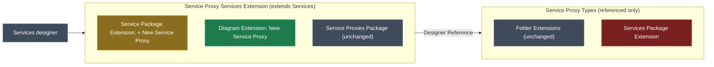

# Create a Service Proxy from a diagram and from the Services package root

## Context

In the Services designer, a developer right-clicks a **diagram** canvas and picks **New Service Proxy**. The mapping dialog opens, they pick the target service, and the new proxy appears on the diagram where they clicked, inside the diagram's folder or package. Right-clicking the **Services package root** in the tree offers the same option. Today it only appears on a **Folder**.

All three menu options live in the `Intent.Modelers.Types.ServiceProxies` module, `Modelers.Types.ServiceProxies` in the solution:

| Location | Where it is defined today | Shows in Services designer? |
| --- | --- | --- |
| Folder | <ModelRef application="Modelers.Types.ServiceProxies" name="Intent.Modelers.Types.ServiceProxies/designers/Service Proxy Types/Folder Extensions" designer="Module Builder" />, an Element Extension in the **referenced** `Service Proxy Types` designer settings | Yes |
| Services package root | <ModelRef application="Modelers.Types.ServiceProxies" name="Intent.Modelers.Types.ServiceProxies/designers/Service Proxy Types/Services Package Extension" designer="Module Builder" />, a **Package** Extension in the same referenced designer settings, added in 5.5.4 | **No**, per this report |
| Diagram | Not defined | No |

<Callout id="diagnosis" tone="risk" title="Why the package option likely never appears">

The 5.5.4 option is defined, but in `Service Proxy Types`. That designer settings has `Extend Designers` empty and only reaches the Services designer through a Designer Reference from <ModelRef application="Modelers.Types.ServiceProxies" name="Intent.Modelers.Types.ServiceProxies/designers/Service Proxy Services Extension" designer="Module Builder" />. Element extensions (Folder) come through that reference. This package extension evidently does not. Every other module that adds a Services-package menu (CQRS, Domain Events) defines its Package Extension directly in a designer settings that **extends** Services. I could not confirm this in a live designer, because no test app here has the module installed. Verification step 5 settles it.

</Callout>

## Approach

Put both entry points in `Service Proxy Services Extension`, the designer settings that already extends the Services designer. The existing **Service Package Extension** there (it only holds an event handler today) gets the package menu option. A new **Diagram Extension** gets the diagram menu option. Then delete the misplaced `Services Package Extension` from `Service Proxy Types`. If it ever did surface, keeping it would show the option twice.

_Green: added. Amber: changed. Red: removed. Grey: unchanged._

## Model changes

<ModelChanges id="mc" caption="Module Builder designer of Modelers.Types.ServiceProxies" changes={[
  { element: "Service Proxy Services Extension / Service Package Extension", designer: "Module Builder", change: "modified",
    note: "Services Package. Add a Context Menu, if it has none, holding the two options below.",
    fields: [
      { label: "Service Proxy (type registration)", after: "Element Creation Option → Service Proxy, Is Option Visible Function `return false;`, Api Model Name ServiceProxies, Default Name Service" },
      { label: "New Service Proxy", after: "Run Script Option, ctrl + shift + p, same icon and script as the Folder option" } ] },
  { element: "Service Proxy Services Extension / Diagram Extension", designer: "Module Builder", change: "added",
    note: "Element Extension typed to the Services designer's `Diagram`, same shape as CQRS's Diagram Extension",
    fields: [
      { label: "Diagram Settings / Context Menu", after: "Run Script Option New Service Proxy (diagram variant script, below)" } ] },
  { element: "Service Proxy Types / Services Package Extension", designer: "Module Builder", change: "removed",
    note: "Superseded by the Service Package Extension above" },
]} />

The diagram script reuses the Folder script and adds two things. It takes the parent from the diagram, the same way DomainInteractions' diagram options use `currentDiagram.getOwner().getParent()`. It places the visual at the click point, the same way Services Types does with `layoutVisuals(..., mousePosition, true)`.

<Code id="diagram-script" language="javascript" caption="Diagram variant of the New Service Proxy script" code={`const diagram = getCurrentDiagram();
const parent = diagram.getOwner().getParent();
let proxy = null;

try {
    proxy = createElement("Service Proxy", "Service", parent.id);
} catch (err) {
    await dialogService.error(\`Unable to create the Service Proxy: \${err}\`);
}

if (proxy != null) {
    try {
        await proxy.launchMappingDialog("df491bea-8a85-4bc9-a93d-41b7abb80ffb");
    } catch (err) {
        if (proxy.getMapping() == null) {
            proxy.delete();
            proxy = null;
        }
    }
}

if (proxy != null) {
    diagram.layoutVisuals([proxy.id], diagram.mousePosition, true);
}`} />

<Callout id="tradeoff-dup" tone="warning" title="Accepted: the creation script is copied a fourth time">

The same script already lives inline on the Folder option, the Services package option, and `Service Proxies Package`. This change adds a diagram variant and moves the package copy. A shared designer `Script` dependency would remove the duplication, but that refactor touches three working options and is out of scope here. It is deferred.

</Callout>

<Callout id="tradeoff-parent" tone="warning" title="Diagram placement: the proxy goes in the diagram's container">

The proxy is created in the folder or package that owns the diagram, not in whichever folder the visuals on screen belong to. This matches how the existing CRUD diagram options in DomainInteractions choose their target.

</Callout>

## Code changes

No hand-written C#. Running the Software Factory on the module regenerates `modelers/Service Proxy Services Extension.designer.settings` and `modelers/Service Proxy Types.designer.settings`. It may also delete or move the generated `ServicesPackageExtensionModel.cs`. That is expected: nothing outside this module's own generated files references it.

## Steps

1. **Version gate**: `Intent.Modelers.Types.ServiceProxies` is at 5.5.6, and 5.5.6 is already published. Bump it to **5.5.7**, matching how 5.5.4's "Improvement" shipped as a patch.
2. **Package option**: under `Service Proxy Services Extension / Service Package Extension`, add the hidden type-registration Element Creation Option and the **New Service Proxy** Run Script Option (ctrl + shift + p, same icon and script as the Folder option).
3. **Diagram option**: add a **Diagram Extension** (Element Extension on the Services `Diagram` type) under `Service Proxy Services Extension`, with Diagram Settings, a Context Menu, and the **New Service Proxy** Run Script Option using the diagram script above.
4. **Remove** `Service Proxy Types / Services Package Extension`, then check that the Module Builder designer reports no validation errors.
5. **Generate and build**: run the Software Factory, review the diffs of both `.designer.settings` files, then run `dotnet build --no-incremental`.
6. **Close out**: dependency audit (no new module dependencies are expected, since Modelers.Services is already one). Add a 5.5.7 entry to `release-notes.md` saying "Improvement: `Service Proxies` can now be created from a Services diagram's context menu" and "Fixed: `New Service Proxy` now appears on the Services package root". No `CONTEXT.md` exists for this module. Create one to record the rule that menu options aimed at the Services designer must live in `Service Proxy Services Extension`, not the referenced `Service Proxy Types`.

## Critical files / elements

- <ModelRef application="Modelers.Types.ServiceProxies" name="Intent.Modelers.Types.ServiceProxies/designers/Service Proxy Services Extension" designer="Module Builder" /> holds both new options
- <ModelRef application="Modelers.Types.ServiceProxies" name="Intent.Modelers.Types.ServiceProxies/designers/Service Proxy Types/Services Package Extension" designer="Module Builder" /> is removed
- <FileRef path="Modules/Intent.Modules.Modelers.Types.ServiceProxies/modelers/Service Proxy Services Extension.designer.settings" change="modified" /> is the regenerated output to inspect
- <FileRef path="Modules/Intent.Modules.Modelers.Types.ServiceProxies/release-notes.md" change="modified" />

## Verification

<Checklist id="verify" items={[
  { id: "v1", label: "Module Builder designer: no validation errors after the changes" },
  { id: "v2", label: "Generated `Service Proxy Services Extension.designer.settings` contains a `packageExtension` for Services Package with the New Service Proxy run script, and an `elementExtension` for Diagram with `diagramSettings` holding it" },
  { id: "v3", label: "`Service Proxy Types.designer.settings` no longer has the Services Package `packageExtension`" },
  { id: "v4", label: "`dotnet build --no-incremental` exits 0 and produces the 5.5.7 `.imod`" },
  { id: "v5", label: "Manual: install 5.5.7 in an app with a Services designer. New Service Proxy appears exactly once on the Services package root, Folder and diagram canvas" },
  { id: "v6", label: "Manual: from a diagram, picking a service creates the proxy in the diagram's folder or package and places it at the click point; cancelling the mapping dialog leaves nothing behind" },
]} />
