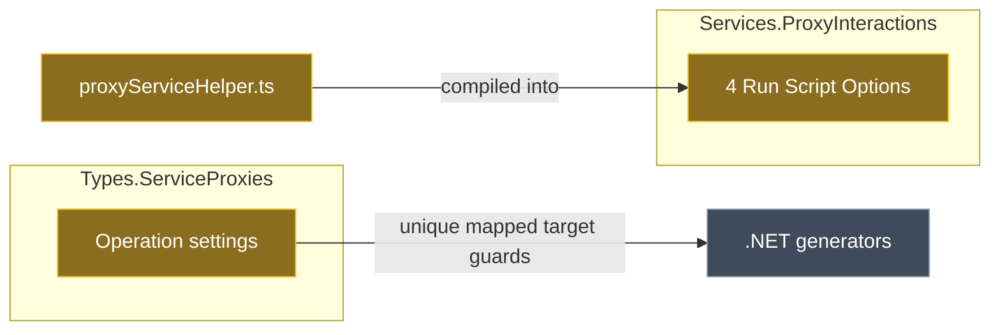

# Let Service Proxy Operations share a name, and guard the mapped target instead

## Context

In the Services designer, a Service Proxy's Operations must have unique names. The rule is **Name Must Be Unique** on the Operation element settings in `Intent.Modelers.Types.ServiceProxies`, added in 5.4.0 as part of a sweep across modules with no proxy-specific reason recorded.

The investigation found that no .NET generator depends on that name. Every generated method is named after the **mapped target**. What breaks generation is **two Operations in one proxy mapped to the same target**: `ToDictionary` / `.Single(...)` in Intent.Modules.NET throw. The name rule doesn't stop that. The only code that does depend on the Operation's own name is the "create from proxy" macro helper in this repo.

**Worked example.** A proxy picks up two `GetById` queries from different folders of the target application. Today the second Operation shows a duplicate-name error. The user renames it to `GetOrderById`, but the generated client method is still `GetByIdAsync`, so the rename changes nothing in the output. After this change, both Operations can stay `GetById`. Mapping the *same* query twice in one proxy becomes the error instead. **Create CQRS Operations** on that proxy then creates `GetByIdQuery` and `GetById2Query`, each linked to its own Operation, instead of silently reusing the first one for both.

This plan covers **this repo only**. Swapping the raw exceptions in Intent.Modules.NET for an `ElementException` is a separate follow-up.

## Approach



*Amber: changed in this plan. Grey: unchanged.*

1. **Designer rule (Types.ServiceProxies):** in the Module Builder, turn off **Name Must Be Unique** on the Operation element settings. Add a **Validate Function** next to it that errors when another Operation under the same proxy maps to the same element. This follows the existing Service Proxy validate function, which already reads `getChildren("Operation")` / `getMapping()?.getElement()`. Service Proxy and Parameter keep their name rules: proxy names feed class names and `HttpClients:{Name}` config keys.
2. **Macro helper (ProxyInteractions):** change `proxyServiceHelper.ts` to find "the existing element for this Operation" by its **Perform Invocation** link, not by name. Recompile, then paste the result into the four Run Script Options that embed it.

<Callout id="no-drift" tone="info" title="Recompile-and-paste is safe here">

The four embedded copies of `ProxyServiceHelper` are identical to each other. They also match the current `proxyServiceHelper.ts` transpiled to ES2020 line for line. So unlike the drifted parameter-sync copies recorded in Types.ServiceProxies' `CONTEXT.md`, a recompile carries no unrelated changes. The implementer still diffs each macro's whole `_dist.js` against its embedded copy before pasting, because only the helper class was compared.

</Callout>

## Model changes

<ModelChanges id="model-changes" caption="Module Builder changes" changes={[
  { element: "Service Proxy / Operation (Element Settings)", designer: "Module Builder — Modelers.Types.ServiceProxies", change: "modified",
    fields: [
      { label: "Name Must Be Unique", before: "true", after: "false" },
      { label: "Validate Function", before: "—", after: "error when a sibling Operation maps to the same element" }
    ] },
  { element: "Create CQRS Operations, Create Service (Service Proxy Extension)", designer: "Module Builder — Modelers.Services.ProxyInteractions", change: "modified",
    note: "Run Script Option script replaced with the recompiled macro" },
  { element: "Create CQRS Operation, Create Service Operation (Service Proxy Operation Extension)", designer: "Module Builder — Modelers.Services.ProxyInteractions", change: "modified",
    note: "Run Script Option script replaced with the recompiled macro" },
  { element: "Intent.Modelers.Types.ServiceProxies (module version)", designer: "Module Builder", change: "modified",
    fields: [{ label: "Version", before: "5.5.8-pre.0", after: "5.5.8-pre.1" }] },
  { element: "Intent.Modelers.Services.ProxyInteractions (module version)", designer: "Module Builder", change: "modified",
    fields: [{ label: "Version", before: "1.1.7", after: "1.1.8-pre.0" }] }
]} />

The Validate Function body, in the same style as the proxy's existing one:

```js
const mapped = getMapping()?.getElement();
if (!mapped) {
    return "";
}
const others = getParent().getChildren("Operation")
    .filter(x => x.id != id && x.getMapping()?.getElement()?.id == mapped.id);
if (others.length == 0) {
    return "";
}
return `Operation '${getName()}' is mapped to '${mapped.getName()}', which is already mapped by ${others.map(x => `'${x.getName()}'`).join(", ")} in this Service Proxy. Remove the duplicate operation.`;
```

<Callout id="unmapped" tone="warning" title="Unmapped Operations are not checked">

An Operation with no mapping, for example one created with **New Operation** or through MCP, returns no error. It can't collide on a target. And `CONTEXT.md` records that adding a validation error for unmapped Operations was deliberately not done in 5.5.7.

</Callout>

## Code changes

`DesignerMacros/src/common/proxyServiceHelper.ts`. It is not generated; it is the TypeScript source the embedded scripts are compiled from.

- **New private helper `findInvoker(candidates, operation)`.** Returns the candidate with a `Perform Invocation` association whose target end points at `operation.id`: `getAssociations("Perform Invocation").some(a => a.isTargetEnd() && a.typeReference?.getTypeId() == operation.id)`. Both `createAppServiceOperationAction` and `createCqrsAction` use it in place of `find(x => x.getName() == …)` as the first lookup.
- **Name fallback, kept for compatibility.** If nothing invokes this Operation, reuse a same-named element **only if it invokes no other proxy Operation**, meaning one made by hand or before the association existed. That is today's behaviour for that case.
- **Name clash → append a number** (the user's choice). If the name belongs to an element invoking a *different* Operation, create a new element with the first free number: `GetById2`, and for CQRS `GetById2Query`, with the number before the `Command`/`Query` suffix.
- **Unchanged:** the `syncElement` semantics (return existing vs update existing), the association and mapping creation for new elements, and `_createService`, which still matches by proxy name because proxy names stay unique.

The four macro entry points (`create-proxy-cqrs-macro-advanced-mapping.ts`, `create-cqrs-proxy-operation-macro-advanced-mapping.ts`, `create-appservice-proxy-macro-advanced-mapping.ts`, `create-appservice-proxy-operation-macro-advanced-mapping.ts`) need no source change. They are only recompiled.

## Steps

1. **Version gate.** Feed search, prereleases included:
   - `Intent.Modelers.Types.ServiceProxies` 5.5.8-pre.0 is already published online, so move the prerelease component to **5.5.8-pre.1**.
   - `Intent.Modelers.Services.ProxyInteractions` 1.1.7 is published, so move it to **1.1.8-pre.0**. Patch: a bug fix to a designer macro.
   - Set both versions in the Module Builder, per `module-version-increment`.
2. **Operation rule.** With `run_designer_script` on Modelers.Types.ServiceProxies' Module Builder, set **Name Must Be Unique** to false on the Operation Settings stereotype and add the Validate Function above. Run the Software Factory, then check that `modelers/Service Proxy Types.designer.settings` shows the Operation with `nameMustBeUnique` false and the new `validateFunction`. The Service Proxy and Parameter rules stay true.
3. **Macro helper.** Edit `proxyServiceHelper.ts` as described. Compile each of the four macro folders with `tsc -p` to produce its `_dist.js`.
4. **Embed.** Diff each `_dist.js` against the script now in its Run Script Option; expect only the helper changes. Then set each script through `run_designer_script` on Modelers.Services.ProxyInteractions' Module Builder. Run the Software Factory and check that all four `<script>` blocks in `modelers/Services Proxy Interactions.designer.settings` carry the new lookup.
5. **Build both modules** with `dotnet build --no-incremental` so the `.imod` is repackaged.
6. **Verify in a designer** (see Verification). No test application in this solution has either module installed, so installing them into one needs your confirmation first.
7. **Close-out**, per the module-building workflow:
   - dependency audit: no new references are expected;
   - `release-notes.md` entries in both modules;
   - check the docs/README for any wording that says Operation names must be unique;
   - `CONTEXT.md` for Types.ServiceProxies: the name rule was dropped, why, and the mapped-target rule;
   - ProxyInteractions has no `CONTEXT.md`. `module-context-capture` decides whether to create one for the invocation-based lookup.

## Critical files / elements

- Module Builder (Modelers.Types.ServiceProxies), element settings `Service Proxy / Operation`: owns the rule.
- Module Builder (Modelers.Services.ProxyInteractions), the four Run Script Options under `Service Proxy Extension` and `Service Proxy Operation Extension`.
- <FileRef path="DesignerMacros/src/common/proxyServiceHelper.ts" line={59} endLine={131} />: the name lookups being replaced.
- <FileRef path="Modules/Intent.Modules.Modelers.Types.ServiceProxies/CONTEXT.md" />: the decision record to update.

## Verification

- **Designer rule.** In a Services designer with the rebuilt module:
  - two proxy Operations with the same name but different targets show **no** error;
  - two Operations mapped to the same target **do** show the new error, on both Operations;
  - renaming one Operation doesn't clear it.
- **Macros.** On a proxy with two same-named Operations mapped to different targets:
  - **Create CQRS Operations** gives `XQuery` and `X2Query`, each with its own Perform Invocation;
  - **Create Service** gives `X` and `X2`;
  - running it again creates nothing new, because both are found by invocation;
  - **Create CQRS Operation** on the second Operation updates `X2Query`, not `XQuery`.
- **Regression.** On a proxy with unique names, the macros produce exactly what they do today, element for element.
- Both modules build with exit code 0, and each regenerated `.designer.settings` diff contains only the intended changes.

<Callout id="deferred" tone="warning" title="Deliberately deferred">

- **Service Proxy on-mapped macro.** It renames children of type `"Service Proxy Operation"`, a type that doesn't exist, so it never runs. It is left alone: fixing it would start removing `Command`/`Query` suffixes from names, which is a separate behaviour change.
- **Intent.Modules.NET.** Replacing the raw `ToDictionary` / `.Single` exceptions with an `ElementException` on the proxy is the next plan.
- **TypeScript/Angular generators (Intent.Modules.Web).** Not checked. Confirm they don't name methods after the proxy Operation before 5.5.8 is released as final.

</Callout>

## Open questions resolved

- **Q:** When a macro creates a Services element whose name already belongs to an element invoking a different proxy Operation, what should it do? **A:** Append a number (`GetById2`, `GetById2Query`).
- **Q:** Where should the changes go first? **A:** This repo (Intent.Modules). The Intent.Modules.NET hardening follows separately.
